# USOL

- 分类：Companies/Factions
- 类型：FRACTION_LOGO
- entryId：019d5d96-a85c-792c-8cf5-7e2e68c3fe21
- 配图：../../img/66B006BC0AB1E85F.png

---

太阳系的主要派系之一。

他们以（一切事物上的）自由为原则，在行事方式中全面拥抱“适者生存”的态度。内部竞争是他们的驱动力，而共同的外部敌人（SOYUZ 与 Terra Mater）又让他们团结在一起；他们主要依靠空间站与小行星基地，而不是殖民地。他们的计划是把太阳系利用到极限，而不去考虑遥远的未来 —— 而他们非常擅长把这一理念落到实处。
