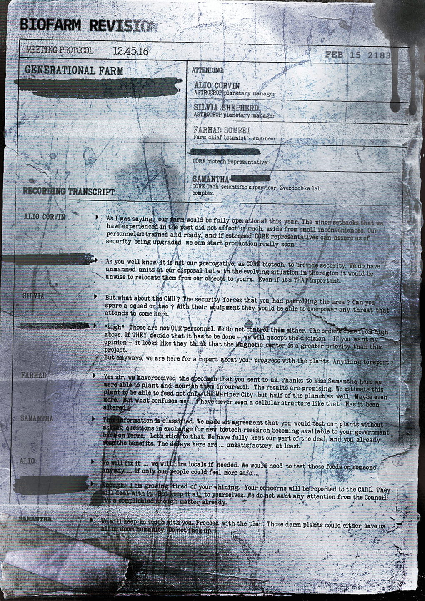

# 生物农场修订记录——代际农场会议（Biofarm Revision Transcript — Generational Farm Meeting）

- 分类：Entry 1: The Contract
- 类型：IMAGE
- entryId：019d5d98-f5d1-7a76-a697-5cdc5bef9342
- 配图：../../img/E33C01B0C54CAB58.png

---

## 图片文字（中文翻译）

> 由配图转录并翻译；原文为英文，专有名词保留原文拼写

**生物农场修订（BIOFARM REVISION）**
会议记录　12.45.16　　　　　　　　2183 年 2 月 15 日

**代际农场（GENERATIONAL FARM）**（标题下方另有一行被涂黑）

出席人员（ATTENDING）：
- ALIO CORVIN —— Astrocrop 行星经理
- SILVIA SHEPHERD —— Astrocrop 行星经理
- FARHAD SORREI —— 农场首席植物学家兼工程师
- ［已涂黑］—— CORE 生物技术代表
- SAMANTHA ［姓氏已涂黑］—— CORE Tech 科学主管，Zvezdochka 实验室综合体

**录音记录（RECORDING TRANSCRIPT）**

**ALIO CORVIN：**
> 就像我刚才说的，我们的农场今年就能全面投产。过去经历的那些小挫折对我们影响不大，只是些小麻烦。我们的人员都受过训练、准备就绪，只要尊敬的 CORE 代表能保证安保升级，我们很快就能开始生产。

**［发言者姓名被涂黑］：**
> 你也清楚，提供安保不是我们 CORE 生物技术的职权。我们手上有无人单位可用，但考虑到该地区不断变化的局势，把它们从我们的目标转移到你们那里并不明智。哪怕这件事真有那么重要。

**SILVIA：**
> 那 CMU 呢？你们派在那一带巡逻的安保部队？能匀出一两个小队吗？有他们的装备，任何找上门的威胁都能被压下去。

**［发言者姓名被涂黑］：**
> *叹气*　那些人不是我们的人。我们也指挥不了他们。命令是从上面来的。如果他们认定必须这么做——那我们就接受这个决定。要我表态的话——看起来他们认为磁力中心比这个项目更重要。
> 不过总之，我们是来听你们关于植物进展的报告的。有什么可汇报的吗？

**FARHAD：**
> 是的，先生。我们已经收到了你们送来的样本。多亏 Samantha 小姐，我们才能自己把它们种下并培育起来。结果很有希望。我们估计这株植物不仅能养活 Mariner City，还能养活半个星球。甚至更多。但让我困惑的是……我从没见过那样的细胞结构。它被改动过吗？

**SAMANTHA：**
> 那个信息是机密。我们有过协议：你们测试我们的植物，不要问问题；作为交换，新的生物技术研究成果会提供给你们的政府——在地球上。我们就按这个来。我们已经完全履行了我们这边的义务，而你们已经在享受好处了。这里的拖延……至少可以说是不能令人满意的。

**ALIO：**
> 我们会解决的……需要的话我们会雇用本地人。反正我们总得找人来试吃那些食物……要是我们的人能更安心一点就好了……

**［发言者姓名被涂黑］：**
> 够了。我已经听腻了你的抱怨。你的顾虑会被上报给 CADL。他们会处理。但你们自己把嘴闭紧。我们不想要议会（Council）的任何注意。这事已经够复杂了。

**SAMANTHA：**
> 我们会和你保持联系。按计划推进。那些该死的植物要么救我们所有人，要么毁掉人类。别把这事搞砸了。

（注：图片下缘部分字迹被污渍与阴影覆盖，上述内容按可辨部分转录；被涂黑处原文即为黑色涂抹。）
