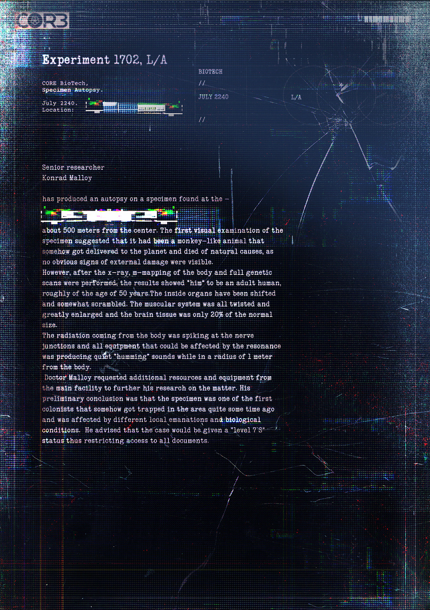

# 生物技术实验 1702——样本尸检报告（Biotech Experiment 1702 — Specimen Autopsy Report）

- 分类：Entry 1: The Contract
- 类型：IMAGE
- entryId：019d5d98-f5d1-7e4e-bee0-eec5aeb4f012
- 配图：../../img/BAA0CDDBB06F08F6.jpg

---

## 图片文字（中文翻译）

> 由配图转录并翻译；原文为英文，专有名词保留原文拼写

**CORE**

**实验 1702，L/A（Experiment 1702, L/A）**

CORE BioTech.
标本尸检（Specimen Autopsy）
2240 年 7 月
地点：［涂黑，无法辨认］

| BIOTECH |
| --- |
| // |
| 2240 年 7 月 |
| // |

**高级研究员 Konrad Malloy**

对一具在 ［已涂黑］ 发现的样本进行了尸检，该处距中心约 500 米。对样本的初步目视检查显示，它曾是一只类似猴子的动物，不知怎么被送到了这颗星球上，并死于自然原因，因为看不到任何明显的外部损伤。

然而，在进行 X 光、m 成像（m-mapping）全身扫描与完整基因扫描之后，结果显示"他"是一名成年人类男性，年龄约 50 岁。内脏已经移位，且有些杂乱。肌肉系统全部扭曲并大幅增生，脑组织只有正常大小的 20%。

尸体发出的辐射在神经接合处出现尖峰，所有可能受共振影响的设备在距尸体 1 米半径内都发出轻微的"嗡鸣"声。

Malloy 医生请求主设施提供更多资源与设备，以便进一步研究此事。他的初步结论是：该样本是最早的殖民者之一，很久以前不知怎么被困在该区域，受到当地不同的辐射散发物与生物条件的影响。他建议将该案定为"7-8 级"状态，从而限制对所有文件的访问。
