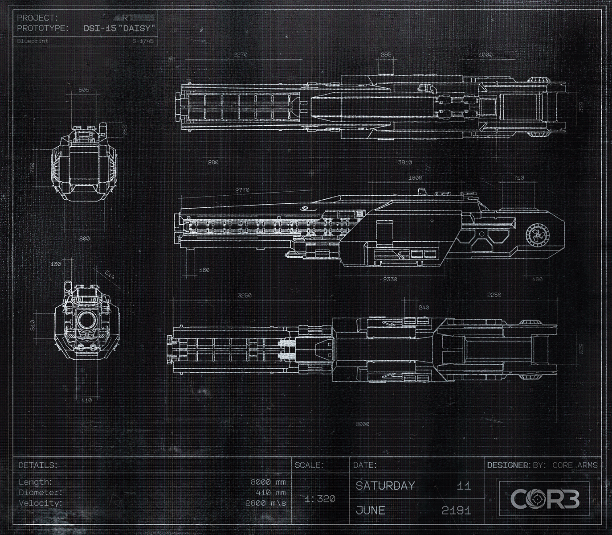

# 黑匣子（Black Box）

- 分类：Entry 1: The Contract
- 类型：IMAGE
- entryId：019d5d98-f5d1-73e2-84d1-1f4fbd5f5e8c
- 配图：../../img/FF420873D2834F1C.png

---

## 图片文字（中文翻译）

> 由配图转录并翻译；原文为英文，专有名词保留原文拼写

**图签（左上）**
- PROJECT（项目）：ARTEMIS
- PROTOTYPE（原型）：DSI-15 "DAISY"
- Blueprint（蓝图编号）：S-1745

**图签（右下）**

| 项目 | 内容 |
| --- | --- |
| DETAILS（参数） | Length（长度）：8000 mm Diameter（直径）：410 mm Velocity（速度）：2800 m/s |
| SCALE（比例） | 1:320 |
| DATE（日期） | SATURDAY（星期六）11　JUNE（六月）2191 |
| DESIGNED BY（设计） | CORE ARMS |

**图面标注**
- 三视图及端面图，尺寸标注可辨者包括：505、200、750、130、440、540、2270、285、700、3310、1800、740、2770、2330、490、3260、2250、240、800、8000（单位 mm）
- 右下角为 CORE 标志
