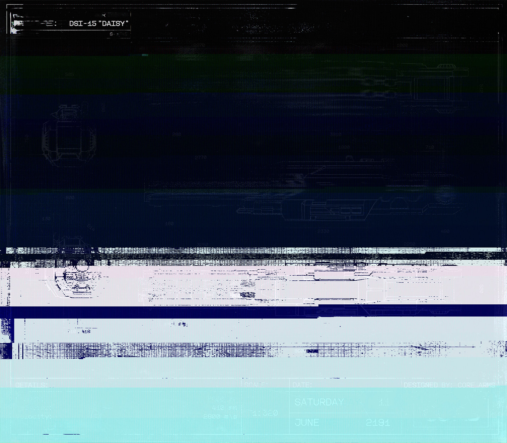

# 蓝图 771-B（Blueprint 771-B）

- 分类：Entry 1: The Contract
- 类型：IMAGE
- entryId：019d5d98-f5d1-754c-8a24-cea44955efc0
- 配图：../../img/098B98DD80F047D2.jpg

---

## 图片文字（中文翻译）

> 由配图转录并翻译；原文为英文，专有名词保留原文拼写

**图签（左上）**
- `PROTOTYPE:`（原型）：DSI-15 "DAISY"
- `Blueprint`（蓝图编号）：S-［编号后半被干扰，无法辨认］

**图签（右下）**

| 项目 | 内容 |
| --- | --- |
| DETAILS（参数） | Length（长度）：［无法辨认］mm Diameter（直径）：410 mm Velocity（速度）：2800 m/s |
| SCALE（比例） | 1:320 |
| DATE（日期） | SATURDAY（星期六）11　JUNE（六月）2191 |
| DESIGNED BY（设计） | CORE ARMS |

**说明**：画面被多条横向色带切割，图纸主体与大部分尺寸标注均不可辨；上表仅收录能清楚读出的字符。
