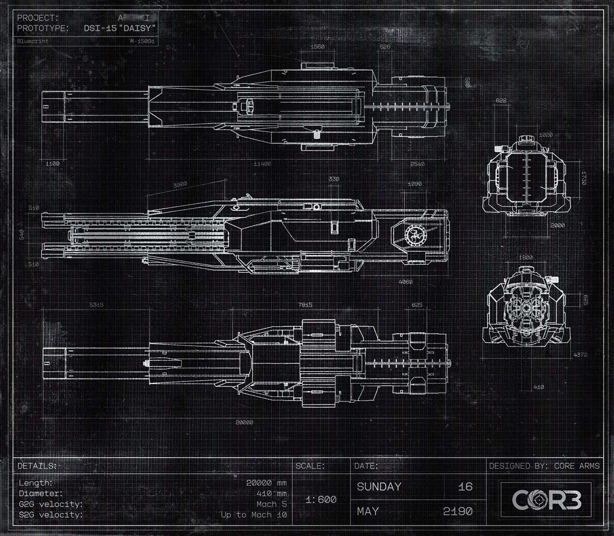

# 蓝图档案 A（Blueprint Archive A）

- 分类：Entry 1: The Contract
- 类型：IMAGE
- entryId：019d5d98-f5d1-7396-b457-e0d14c357951
- 配图：../../img/9D2103035EC8E09C.png

---

## 图片文字（中文翻译）

> 由配图转录并翻译；原文为英文，专有名词保留原文拼写

**图签（左上）**
- PROJECT（项目）：［被擦除，仅余末尾笔画，无法辨认］
- PROTOTYPE（原型）：DSI-15 "DAISY"
- Blueprint（蓝图编号）：M-15094

**图签（右下）**

| 项目 | 内容 |
| --- | --- |
| DETAILS（参数） | Length（长度）：20000 mm Diameter（直径）：410 mm G2G velocity（G2G 速度）：Mach 5 S2G velocity（S2G 速度）：Up to Mach 10 |
| SCALE（比例） | 1:600 |
| DATE（日期） | SUNDAY（星期日）16　MAY（五月）2190 |
| DESIGNED BY（设计） | CORE ARMS |

**图面标注**
- 三视图与两个端面图；尺寸标注可辨者包括：1560、826、2005、1100、11400、2840、622、1020、3900、330、1090、1720、510、540、510、4060、2000、5315、7815、625、1800、4372、410、20000（单位 mm）
