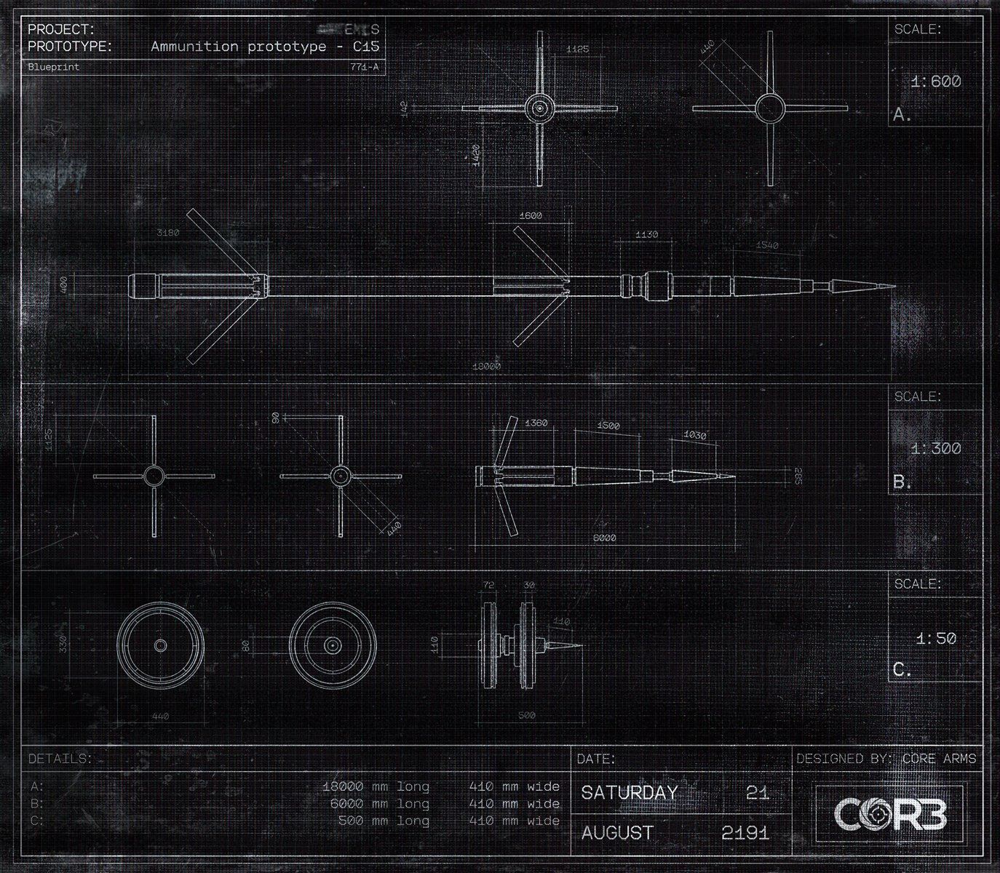

# 蓝图档案 B（Blueprint Archive B）

- 分类：Entry 1: The Contract
- 类型：IMAGE
- entryId：019d5d98-f5d1-7aad-b4e5-cdc57d0d28dc
- 配图：../../img/C24785C581A7B35D.png

---

## 图片文字（中文翻译）

> 由配图转录并翻译；原文为英文，专有名词保留原文拼写

**图签（左上）**
- PROJECT（项目）：［被涂抹，仅余末尾 "…ARMS"］
- PROTOTYPE（原型）：Ammunition prototype - C45（弹药原型 C45）
- Blueprint（蓝图编号）：771-A

**比例（右侧三处）**

| 视图 | SCALE（比例） |
| --- | --- |
| A | 1:600 |
| B | 1:300 |
| C | 1:50 |

**图签（右下）**

| DETAILS（参数） | 长度 / 宽度 |
| --- | --- |
| A | 13000 mm long　410 mm wide |
| B | 6000 mm long　410 mm wide |
| C | 500 mm long　410 mm wide |

| 项目 | 内容 |
| --- | --- |
| DATE（日期） | SATURDAY（星期六）21　AUGUST（八月）2191 |
| DESIGNED BY（设计） | CORE ARMS |

**图面标注**
- 可辨尺寸：1125、440、440、3180、1500、1130、1540、18000、1420、60、1380、1500、1030、6600、22、30、440、72、30、110、330、80、440、500（单位 mm）
- 右下角为 CORE 标志
