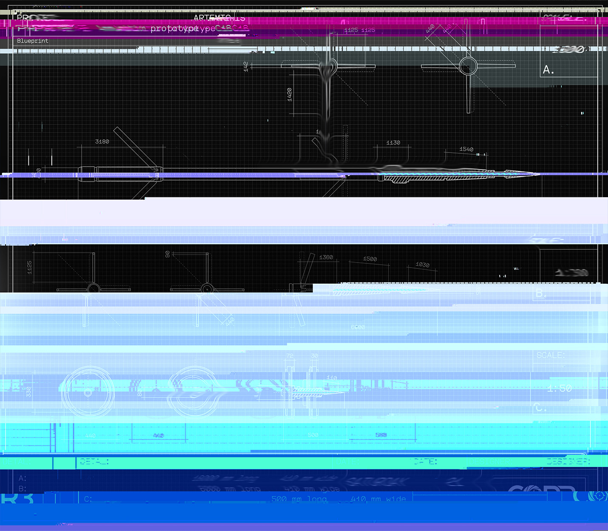

# 蓝图 S-1745（Blueprint S-1745）

- 分类：Entry 1: The Contract
- 类型：IMAGE
- entryId：019d5d98-f5d1-7b15-ad05-5a4464aea3cf
- 配图：../../img/A9B7B5C233751158.jpg

---

## 图片文字（中文翻译）

> 由配图转录并翻译；原文为英文，专有名词保留原文拼写

**图签（左上）**
- PROJECT（项目）：［仅"ARTEMIS"字样隐约可辨，其余被干扰覆盖］
- PROTOTYPE（原型）：…prototype C45（弹药原型 C45）
- Blueprint（蓝图编号）：S-［编号后半被干扰，无法辨认］

**比例**
- A 图：1:600

**图签（右下）**

| DETAILS（参数） | 长度 / 宽度 |
| --- | --- |
| A | 13000 mm long　410 mm wide |
| B | 6000 mm long　410 mm wide |
| C | 500 mm long　410 mm wide |

- DATE（日期）：［被色带遮盖，无法辨认］
- DESIGNED BY（设计）：CORE ARMS

**说明**：画面被多条横向色带切割，A/B/C 三组视图（含弹体侧视与端面）大多残缺；上表仅收录能清楚读出的字符。
