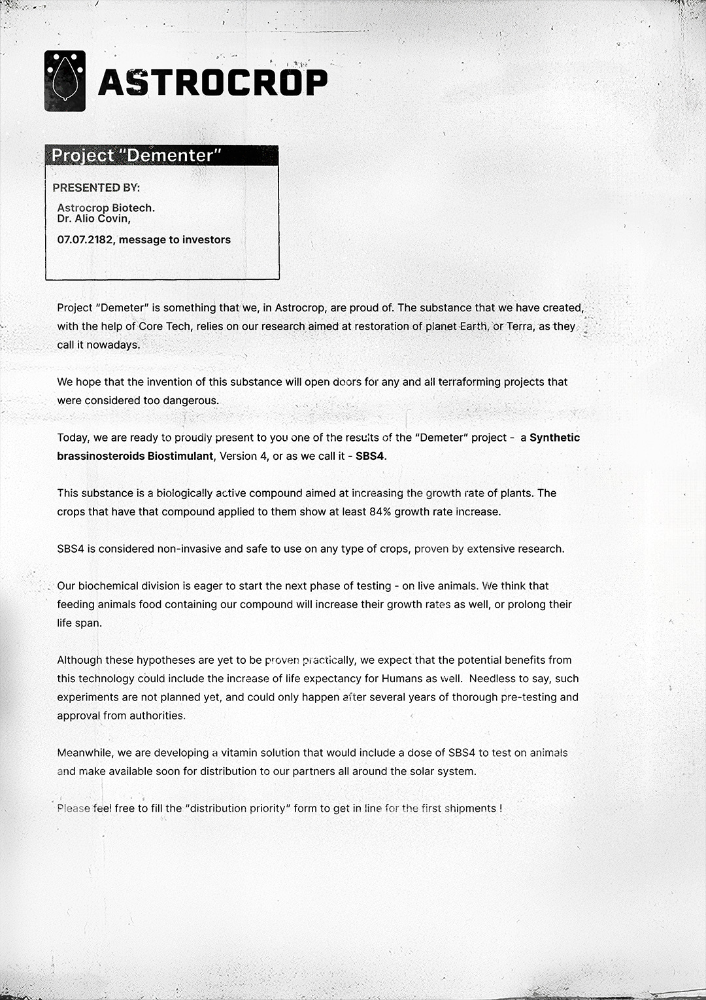

# 货运清单（Cargo Manifest）

- 分类：Entry 1: The Contract
- 类型：IMAGE
- entryId：019d5d98-f5d1-73a2-938c-c49c83ff5e46
- 配图：../../img/E57CADFD96EB43B1.jpg

---

## 图片文字（中文翻译）

> 由配图转录并翻译；原文为英文，专有名词保留原文拼写

**ASTROCROP**

**项目"德墨忒尔"（Project "Dementer"）**

提交人：
Astrocrop Biotech.
Dr. Allo Covin，
07.07.2182，致投资者的信

项目"Demeter"是我们 Astrocrop 引以为傲的成果。我们所创造的物质，是在 Core Tech 的帮助下，基于我们旨在恢复地球（Earth，或如他们如今的叫法——Terra）的研究。

我们希望这种物质的发明，能为所有曾被认为过于危险的地球化改造（terraforming）项目打开大门。

今天，我们准备自豪地向各位展示"Demeter"项目的成果之一——一种**合成油菜素内酯类生物刺激素，第 4 版**，或者我们称之为——**SBS4**。

这种物质是一种生物活性化合物，旨在提高植物的生长速度。施用过该化合物的作物显示出至少 84% 的生长速率提升。

SBS4 被认为是非侵入性的，可安全用于任何类型的作物，这一点已由大量研究证实。

我们的生化部门渴望开始下一阶段的测试——在活体动物身上。我们认为，用含有我们化合物的饲料喂养动物，同样会提高它们的生长速度，或延长其寿命。

尽管这些假设尚待实践验证，但我们预计这项技术的潜在益处也可能包括提高人类的预期寿命。不用说，此类实验目前尚未计划，只有在经过数年的充分预测试并获得主管部门批准后才可能进行。

与此同时，我们正在开发一种维生素溶液，其中会含有一定剂量的 SBS4，用于动物测试，并尽快提供给太阳系各地的合作伙伴。

欢迎填写"配送优先级（distribution priority）"表格，以排在首批发货的队列中！
