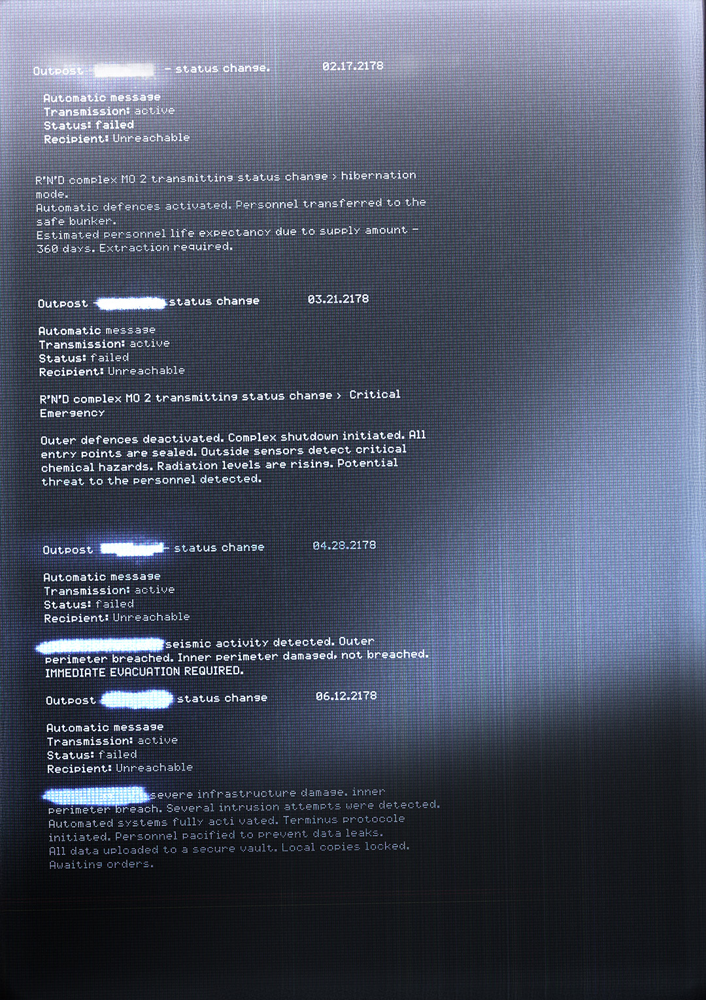

# 综合体状态（Complex Status）

- 分类：Entry 1: The Contract
- 类型：IMAGE
- entryId：019d5d98-f5d1-7f79-b449-b43ae515e314
- 配图：../../img/339C70F23AC25F71.jpg

---

## 图片文字（中文翻译）

> 由配图转录并翻译；原文为英文，专有名词保留原文拼写

（画面为终端屏幕上的四段自动状态报告；前哨站名称均被白色涂抹遮盖。）

**Outpost［名称已涂黑］——状态变更　　02.17.2178**

自动消息
传输：活动
状态：失败
接收方：不可达

R'N'D 综合体 MO 2 正在发送状态变更 > 休眠模式。
自动防御已启动。人员已转移至安全掩体。
按补给量估算的人员预期寿命——360 天。需要撤离。

**Outpost［名称已涂黑］——状态变更　　03.21.2178**

自动消息
传输：活动
状态：失败
接收方：不可达

R'N'D 综合体 MO 2 正在发送状态变更 > 严重紧急情况

外部防御已停用。综合体停机程序已启动。所有入口均已封闭。外部传感器检测到严重化学危害。辐射水平正在上升。检测到对人员的潜在威胁。

**Outpost［名称已涂黑］——状态变更　　04.28.2178**

自动消息
传输：活动
状态：失败
接收方：不可达

［名称已涂黑］检测到地震活动。外围边界被突破。内围边界受损，但未被突破。需要立即撤离。

**Outpost［名称已涂黑］——状态变更　　06.12.2178**

自动消息
传输：活动
状态：失败
接收方：不可达

［名称已涂黑］严重基础设施损坏。内围边界被突破。检测到数次入侵尝试。自动化系统已全部启动。Terminus 协议已启动。为防止数据泄露，人员已被"安抚"。
所有数据已上传至安全金库。本地副本已锁定。等待命令。
