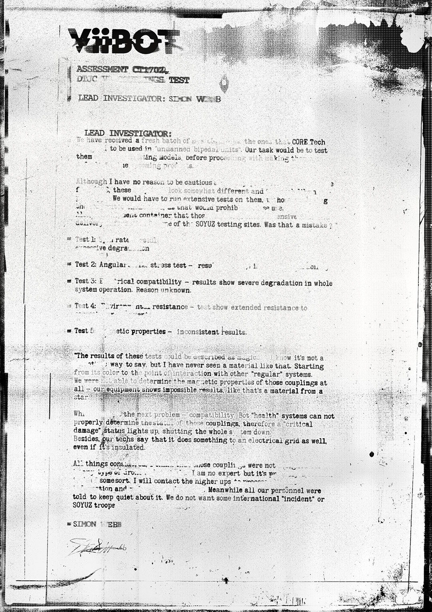

# 受损文件（Damaged Document）

- 分类：Entry 1: The Contract
- 类型：IMAGE
- entryId：019d5d98-f5d1-7e59-b785-fd3a44fb2c3b
- 配图：../../img/5C9BB5C8D12C517B.jpg

---

## 图片文字（中文翻译）

> 由配图转录并翻译；原文为英文，专有名词保留原文拼写

（纸张严重污损、撕裂，多处字迹缺失或被墨迹覆盖。）

**ViBOT**
评估 CT1702
药物［无法辨认］测试
首席调查员：SIMON WEBB

**首席调查员：**
我们收到了一批新的［无法辨认］，就是 CORE Tech 送来的那些，将用于"无人双足单位（unmanned bipedal units）"。我们的任务是在［无法辨认］模型上测试它们，然后再进行［无法辨认］。
［无法辨认］正在生产中。

虽然我没有理由保持谨慎，但［无法辨认］这些［无法辨认］看起来有些不同，而且［无法辨认］。我们将不得不对它们进行大量测试，［无法辨认］。［无法辨认］那会禁止［无法辨认］使用［无法辨认］。［无法辨认］容器那……易燃的［无法辨认］，从 SOYUZ 测试场送来。那算不算个错误？

- 测试 1：［无法辨认］率——结果：［无法辨认］，过度退化
- 测试 2：角度［无法辨认］应力测试——结果：［无法辨认］
- 测试 3：电兼容性——结果显示整个系统运行严重退化。原因不明。
- 测试 4：环境［无法辨认］耐受性——测试显示对［无法辨认］的耐受性延长
- 测试 5：磁［无法辨认］特性——结果不一致。

这些测试的结果可以用"［无法辨认］"来形容。我知道这不是［无法辨认］说法。但我从没见过那样的材料。从它的颜色，到它与其他"常规"系统的相互作用。我们完全无法确定这些耦合（couplings）的磁性特性——我们的设备显示出不可能的结果，就像那是来自［无法辨认］星的材料。

接下来的问题是兼容性。BOT 的"健康"系统无法正确判定这些耦合的状态，因此"严重损坏"状态会亮起，把整个系统关停。此外，我们的技术员说，即使做了绝缘，它也会对电网产生影响。

在所有情况中［无法辨认］这些耦合都［无法辨认］……我不是专家，但这是某种［无法辨认］。我会联系上级［无法辨认］。同时我们所有人员都被要求对此保持沉默。我们不想要什么国际"事件"，也不想要 SOYUZ 部队［无法辨认］。

**SIMON WEBB**
（手写签名）
