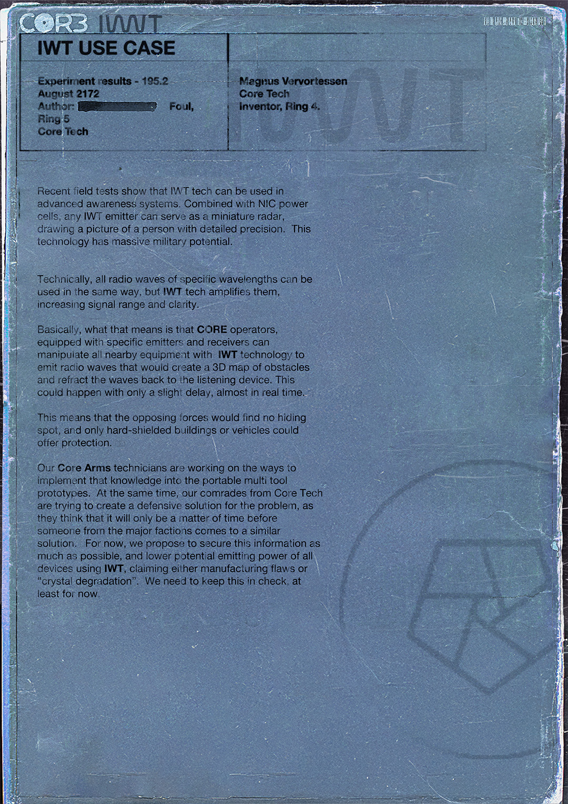

# IWT 用例（IWT Use Case）

- 分类：Entry 1: The Contract
- 类型：IMAGE
- entryId：019d5d98-f5d1-70bd-8892-f3f4ce36eb3f
- 配图：../../img/FAC964147837A670.jpg

---

## 图片文字（中文翻译）

> 由配图转录并翻译；原文为英文，专有名词保留原文拼写

**CORE　IWT**

**IWT 用例（IWT USE CASE）**

| | |
| --- | --- |
| 实验结果 - 195.2 2172 年 8 月 作者：［涂黑］ Foul， Ring 5 Core Tech | Magnus Vervortessen Core Tech 发明者，Ring 4 |

最近的实地测试表明，IWT 技术可用于先进的态势感知系统。与 NIC 电芯结合后，任何 IWT 发射器都能充当微型雷达，绘制出精确到具体人物细节的图像。这项技术具有巨大的军事潜力。

从技术上说，任何特定波长的无线电波都可以用同样的方式使用，但 IWT 技术会对其放大，提高信号距离与清晰度。

基本上，这意味着装备了特定发射器与接收器的 CORE 操作员，可以用 IWT 技术操纵附近所有设备，发出能绘制障碍物 3D 地图的无线电波，并把波折射回监听设备。这一切只会有轻微延迟，几乎实时完成。

这意味着敌对势力将无处藏身，只有硬屏蔽的建筑或载具能提供保护。

我们的 Core Arms 技术人员正在研究如何把这些知识应用到便携式多功能工具原型中。与此同时，我们 Core Tech 的同志们正试图为这个问题找出防御方案，因为他们认为，其他主要阵营中迟早会有人得出类似方案。目前我们建议尽可能保密这些信息，并降低所有使用 IWT 的设备的潜在发射功率，对外则宣称是制造缺陷或"晶体退化"。至少目前，我们得把这件事压住。
