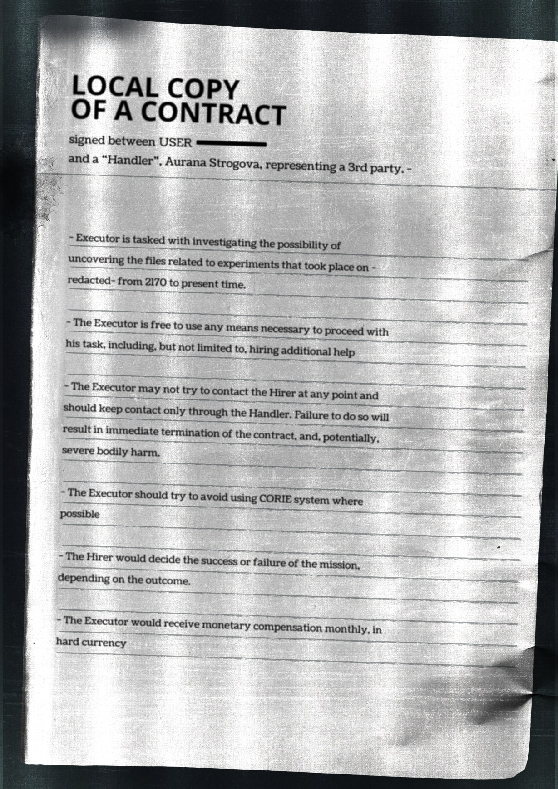

# 奥拉娜·斯特罗戈娃经办人协议——合同本地副本（Local Contract Copy — Handler Agreement (Aurana Strogova)）

- 分类：Entry 1: The Contract
- 类型：IMAGE
- entryId：019d5d98-f5d1-7272-b65f-078f45281474
- 配图：../../img/3440772B4B41FAAA.jpg

---

## 图片文字（中文翻译）

> 由配图转录并翻译；原文为英文，专有名词保留原文拼写

**合同本地副本（LOCAL COPY OF A CONTRACT）**

由 USER ［已涂黑］ 与"经办人"（Handler）Aurana Strogova（代表第三方）签署

---

- 执行者（Executor）的任务是：调查是否有机会找到与 2170 年至今在 ［已删节］ 进行的实验相关的文件。

- 执行者可以自由使用任何必要手段以推进任务，包括但不限于雇用额外帮手。

- 执行者在任何时候都不得尝试联系雇主（Hirer），只应通过经办人保持联系。违反此条将导致合同立即终止，并可能造成严重的人身伤害。

- 在可能的情况下，执行者应尽量避免使用 CORIE 系统。

- 任务的成功或失败将由雇主根据结果判定。

- 执行者将按月以硬通货（hard currency）形式获得报酬。
