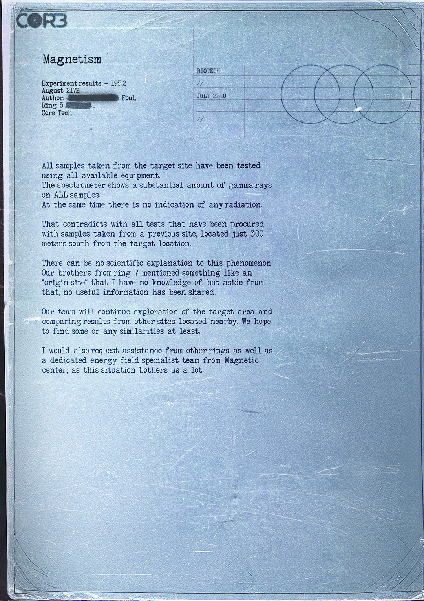

# 磁性异常报告——Core Tech 实地研究（Magnetism Anomaly Report — Core Tech Field Study）

- 分类：Entry 1: The Contract
- 类型：IMAGE
- entryId：019d5d98-f5d1-700e-8fc8-574bb3688c77
- 配图：../../img/846CF56B0E922075.png

---

## 图片文字（中文翻译）

> 由配图转录并翻译；原文为英文，专有名词保留原文拼写

**CORE**

**磁性（Magnetism）**

实验结果 – 195.2
2172 年 8 月
作者：［涂黑］ Foul，
Ring 5［涂黑］，
Core Tech

| BIOTECH |
| --- |
| // |
| 2240 年 7 月 |
| // |

（右上另有一组三个交叠圆圈，圈内标注 1702）

从目标地点采集的所有样本，都已用现有全部设备检测过。
光谱仪显示所有样本中都含有大量伽马射线。
与此同时，却没有任何辐射迹象。

这与之前从另一地点采集的样本所做的全部测试相矛盾——那个地点位于目标位置以南仅 300 米处。

这一现象没有科学解释。Ring 7 的兄弟们提到过某种"origin site（起源点）"，我对此一无所知；除此之外，他们没有分享任何有用信息。

我们团队将继续勘探目标区域，并比对附近其他地点的结果。我们希望至少能找到某些相似之处。

我也会请求其他 Ring 的协助，以及来自 Magnetic center 的专职能量场专家团队，因为这件事让我们非常不安。
