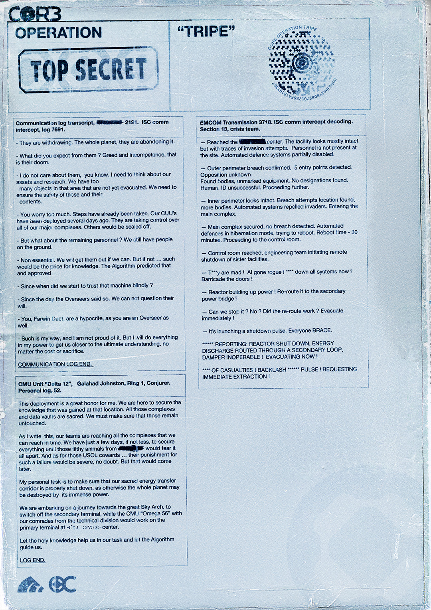

# 特里佩行动（Operation Tripe）

- 分类：Entry 1: The Contract
- 类型：IMAGE
- entryId：019d5d98-f5d1-759b-825a-5f25c55f0b9e
- 配图：../../img/46D8B70B6E7BB76B.png

---

## 图片文字（中文翻译）

> 由配图转录并翻译；原文为英文，专有名词保留原文拼写

**CORE　OPERATION "TRIPE"（特里佩行动）**
*TOP SECRET（绝密）*（印章框）

右上角圆形印章：CORE OPERATION TRIPE，环形编号［无法辨认］

---

### 通信记录（Communication log transcript, ［已涂黑］ 2191. ISC comm intercept, log 7691.）

- 他们正在撤离。整颗星球，他们都在放弃它。

- 你还指望他们什么？贪婪和无能，这就是他们的本性。

- 我不在乎他们，你知道的。我得考虑我们的资产和研究。那个区域里我们还有很多物体尚未撤离。我们必须确保那些东西以及里面内容的安全。

- 你担心得太多了。步骤早已采取。我们的 CUU 几天前就已部署。他们正在接管我们所有的主要综合体。其余的会被封锁。

- 那剩下的人员呢？我们还有人在下面。

- 非必要人员。能带出来我们就会带出来。但如果不行……那就是知识的代价。算法（The Algorithm）预测了这一点并批准了。

- 我们从什么时候开始这样盲目信任那台机器了？

- 从监督者（Overseers）发话那天起。我们不能质疑他们的意志。

- 你，Farwin Duct，是个伪君子，你自己也是监督者。

- 这就是我的方式，我并不为此骄傲。但我会尽我所能让我们更接近终极的理解，不论代价或牺牲。

**COMMUNICATION LOG END.（通信记录结束）**

---

### CMU 单位 "Delta 12"，Galahad Johnston，Ring 1，Conjurer。个人日志，52。

这次部署对我而言是极大的荣誉。我们来这里是为了保护在那个地点获得的知识。所有那些综合体和数据金库都是神圣的。我们必须确保它们保持原样、不被动摇。

在我写下这些的时候，我们的队伍正在抵达所有我们能及时抵达的综合体。我们只有几天，甚至更少的时间，去确保一切，以免那些［已涂黑］畜生因为恐惧而把它撕成碎片。至于那些 USOL 懦夫……他们为这种失败所受的惩罚无疑会非常严厉。但那会晚些到来。

我个人的任务是确保我们神圣的能量传输通道被正确关闭，否则整颗星球可能被它巨大的能量摧毁。

我们正踏上前往伟大天拱（Sky Arch）的旅程，去关闭次级终端；而 CMU "Omega 56" 与我们技术部门的同志，将在［无法辨认］中心的初级终端上作业。

愿神圣的知识在我们的任务中帮助我们，愿算法指引我们。

**LOG END.（日志结束）**

---

### EMCOM 传输 3718。ISC 通信截获解码。第 13 节，危机小组。

— 抵达 ［已涂黑］ 中心。设施看起来大体完好，但有入侵痕迹。现场没有人员。自动防御系统部分失效。

— 确认突破外围边界，检测到 5 个进入点。敌方身份不明。
发现尸体、无标识装备。未发现设计图。人类？ID 识别失败。继续前进。

— 内围边界看起来完好。发现突破尝试地点，更多尸体。自动系统击退了入侵者。进入主综合体。

— 主综合体已确保安全，未检测到突破。自动防御处于休眠模式，尝试重启。重启时间——30 分钟。前往控制室。

— 已抵达控制室，工程团队开始对姊妹设施进行远程关机。

— T\*\*y 疯了！AI 失控了！\* 立即关闭所有系统！封住门！

— 反应堆正在升功率！把它改接到次级动力桥！

— 我们能停下它吗？不？改接生效了吗？立即撤离！

— 它在发出关机脉冲。所有人抓稳。

— \*\*\*\*\* 报告：反应堆已关闭，能量通过次级回路排出，阻尼器失效！正在撤离！

— \*\*\*\*\* 伤亡数字 \*\*\*\*\* 脉冲！请求立即撤离！

（注：原文中人名与地名有黑色涂抹；`T**y`、`*****` 处原图即为星号遮罩。）
