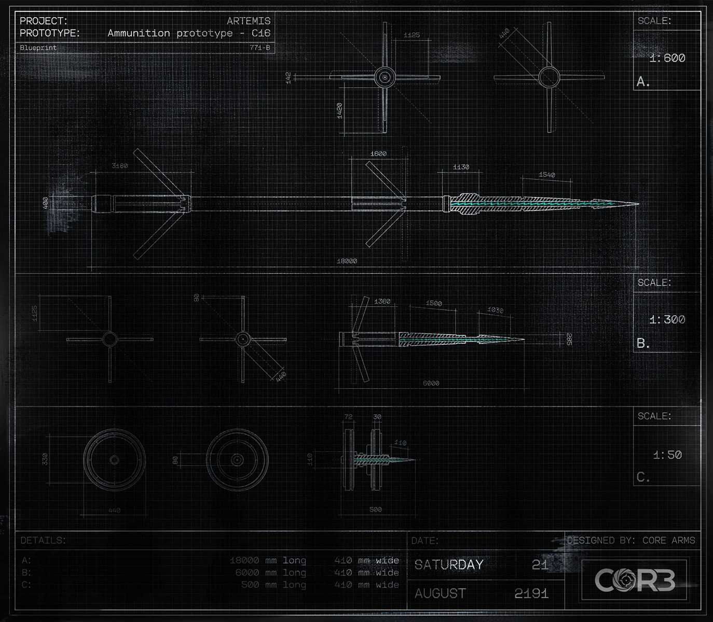

# 密码（Passwords）

- 分类：Entry 1: The Contract
- 类型：IMAGE
- entryId：019d5d98-f5d1-7b53-bbe3-9305dc58823d
- 配图：../../img/948F2F09C07477AA.png

---

## 图片文字（中文翻译）

> 由配图转录并翻译；原文为英文，专有名词保留原文拼写

**图纸标题栏**

- 项目（PROJECT）：ARTEMIS
- 原型（PROTOTYPE）：Ammunition prototype - C16（弹药原型 - C16）
- 图纸编号（Blueprint）：771-B
- 比例（SCALE）：1:600（A 视图）｜1:300（B 视图）｜1:50（C 视图）

**细节表（DETAILS）**

| 视图 | 长度 | 宽度 |
| --- | --- | --- |
| A | 18000 mm | 410 mm |
| B | 6000 mm | 410 mm |
| C | 500 mm | 410 mm |

- 日期（DATE）：2191 年 8 月 21 日，星期六
- 设计方（DESIGNED BY）：CORE ARMS
- 右下标：COR3

各视图旁另有多处尺寸标注（单位 mm，可见者有 18000、6000、500、1130、1540、1600、3180、1125、440、295、330 等）。

（注：本页配图为 ARTEMIS 项目弹药图纸，画面中未出现任何密码、账号或口令内容。）
