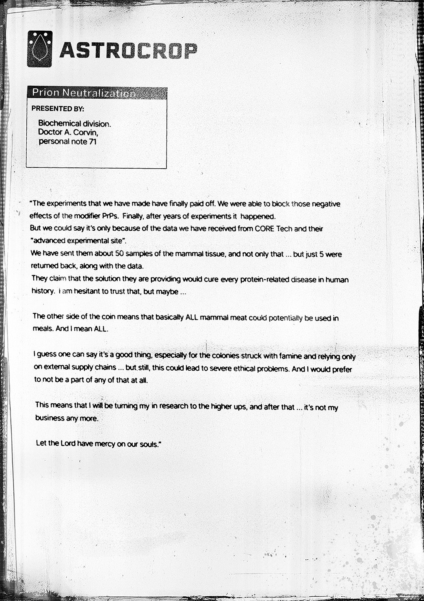

# 朊病毒中和（Prion Neutralization）

- 分类：Entry 1: The Contract
- 类型：IMAGE
- entryId：019d5d98-f5d1-7b9b-82f6-82f2445c9705
- 配图：../../img/6B4D9A6C08BDFF48.jpg

---

## 图片文字（中文翻译）

> 由配图转录并翻译；原文为英文，专有名词保留原文拼写

**ASTROCROP**（徽标：水滴形图案）

| 项目 | 内容 |
| --- | --- |
| 标题 | Prion Neutralization（朊病毒中和） |
| 提交人（PRESENTED BY） | Biochemical division（生化部） Doctor A. Corvin，personal note 71（个人笔记 71） |

> 「我们做过的实验终于有了回报。我们成功阻断了修饰 PrP（modifier PrPs）的那些负面效应。经过多年实验，这一刻终于到来了。
>
> 但可以说，这仅仅是因为我们从 CORE Tech 及其"高级实验场"（advanced experimental site）得到的数据。
>
> 我们送去了大约 50 份哺乳动物组织样本，不止这些……但只退回了 5 份，连同数据一起。
>
> 他们声称，他们提供的解决方案能治愈人类历史上所有与蛋白质相关的疾病。我对此持怀疑态度，但也许吧……
>
> 硬币的另一面意味着，基本上所有哺乳动物的肉都可能被用于餐食。我是说，全部（ALL）。
>
> 我想可以说这是件好事，尤其是对那些遭受饥荒、只能依赖外部供应链的殖民地……但尽管如此，这可能导致严重的伦理问题。而我宁愿完全不参与其中。
>
> 这意味着我将把我的研究上交上级，在那之后……就不关我的事了。
>
> 愿主怜悯我们的灵魂。」
