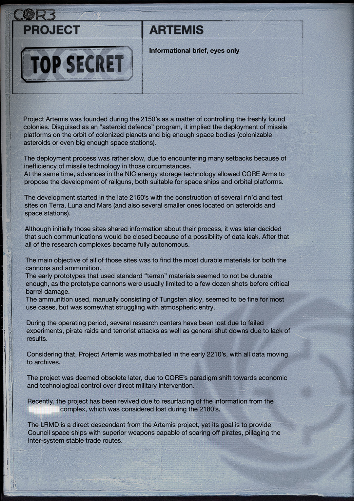

# 阿耳忒弥斯计划（Project Artemis）

- 分类：Entry 1: The Contract
- 类型：IMAGE
- entryId：019d5d98-f5d1-7555-ba3f-271ba856993f
- 配图：../../img/4D472736E6B1CF5C.jpg

---

## 图片文字（中文翻译）

> 由配图转录并翻译；原文为英文，专有名词保留原文拼写

**页眉**

- 左上标志：COR3
- 项目（PROJECT）：ARTEMIS
- 密级印章：TOP SECRET（绝密）
- 说明：Informational brief, eyes only（情报简报，仅限本人阅读）

**正文**

阿尔忒弥斯计划（Project Artemis）创立于 2150 年代，目的是控制新近发现的殖民地。它被伪装成一项"小行星防御"计划，实际意味着在被殖民行星以及足够大的天体（可殖民的小行星，甚至足够大的空间站）轨道上部署导弹平台。

部署进程相当缓慢，因为在那种环境下导弹技术效率低下，遇到了许多挫折。
与此同时，NIC 储能技术的进步使 CORE Arms 得以提出研发轨道炮（railguns），既适用于飞船，也适用于轨道平台。

研发始于 2160 年代末，在 Terra、Luna 和 Mars 上建造了若干研发与试验场（此外还有位于小行星和空间站上的几个较小场站）。

尽管起初这些场站会共享各自的进程信息，但后来决定关闭此类通信，以防数据泄露。此后所有研究综合设施完全自治。

所有这些场站的主要目标，是为炮管和弹药寻找最耐久的材料。
使用标准"地球（terran）"材料的早期原型似乎不够耐久，原型炮管通常在发射几十发后就出现严重损伤。
所使用的弹药主要由钨合金构成，在大多数使用场景下似乎尚可，但在大气层再入方面有些吃力。

在运作期间，若干研究中心因实验失败、海盗袭击和恐怖袭击而损失，也有因缺乏成果而被整体关停的。

有鉴于此，阿尔忒弥斯计划于 2210 年代初被封存，所有数据转入档案。

后来该计划被认为已经过时，因为 CORE 的范式转向了以经济与技术控制取代直接军事干预。

最近，由于来自 [已涂黑] 综合设施的信息重新浮出水面（该设施被认为在 2180 年代失踪），该计划被重启。

LRMD 是阿尔忒弥斯计划的直接后裔，但其目标是为议会（Council）的飞船提供更优越的武器，足以吓退海盗、劫掠跨星系稳定贸易航线。
