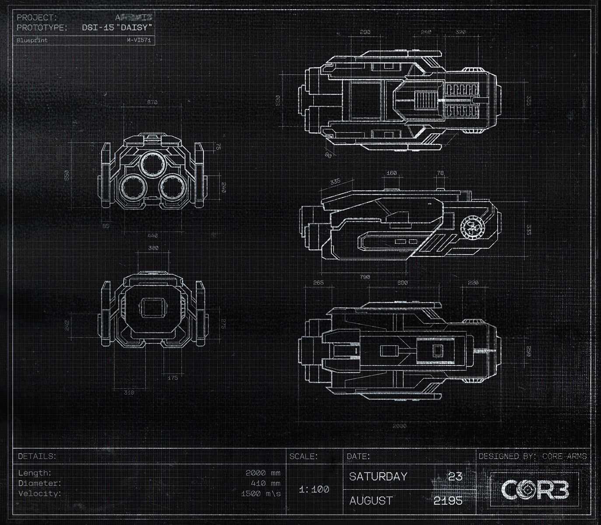

# 无线电通信日志（Radio Communication Log）

- 分类：Entry 1: The Contract
- 类型：IMAGE
- entryId：019d5d98-f5d1-7cbb-aad4-894f1500dbea
- 配图：../../img/4FE4904B47115AEC.png

---

## 图片文字（中文翻译）

> 由配图转录并翻译；原文为英文，专有名词保留原文拼写

**图纸标题栏**

- 项目（PROJECT）：ARTEMIS（字样上方有污损）
- 原型（PROTOTYPE）：DST-15 "DAISY"
- 图纸编号（Blueprint）：M-VI571

**细节表（DETAILS）**

| 项目 | 数值 |
| --- | --- |
| 长度（Length） | 2000 mm |
| 直径（Diameter） | 410 mm |
| 速度（Velocity） | 1500 m/s |

- 比例（SCALE）：1:100
- 日期（DATE）：2195 年 8 月 23 日，星期六
- 设计方（DESIGNED BY）：CORE Arms
- 右下标：COR3

各视图旁另有多处尺寸标注（单位 mm，可见者有 2000、790、600、230、335、160、78、530、355、670、240、75、550、85、440、300、175、310、265 等）。

（注：本页配图为 DST-15 "DAISY" 原型图纸，画面中未出现任何无线电通信记录文字。）
