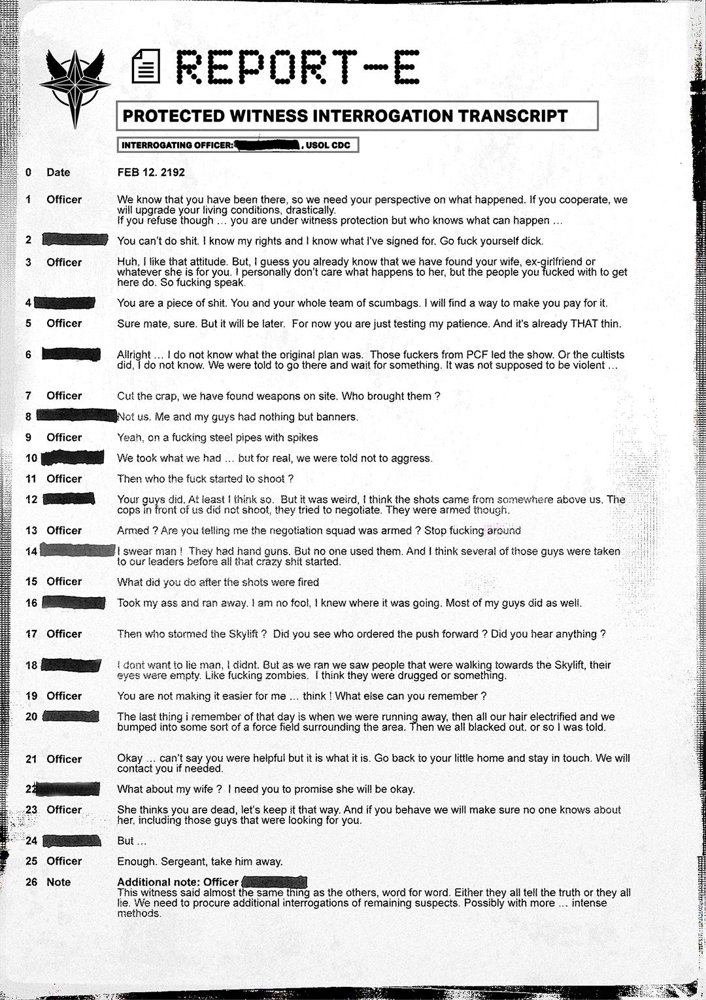

# 报告 E（Report E）

- 分类：Entry 1: The Contract
- 类型：IMAGE
- entryId：019d5d98-f5d1-764e-b66f-07f00b4bda26
- 配图：../../img/71068A06A96DD1A2.png

---

## 图片文字（中文翻译）

> 由配图转录并翻译；原文为英文，专有名词保留原文拼写

**页眉**

- 左上：USOL 徽记
- 标题：REPORT-E（报告 E）
- 副标题：PROTECTED WITNESS INTERROGATION TRANSCRIPT（受保护证人审讯记录）
- 审讯官（INTERROGATING OFFICER）：[已涂黑]，USOL CDC

**记录正文**

**0　Date（日期）**：FEB 12. 2192（2192 年 2 月 12 日）

**1　Officer（警官）**：我们知道你当时在场，所以需要你对所发生之事的说法。如果你配合，我们会改善你的生活条件。如果你拒绝……你虽在证人保护之下，但谁知道会发生什么……

**2　[已涂黑]**：你什么都做不了。我知道我的权利，也知道我签了什么。滚你妈的，混蛋。

**3　Officer**：哈，我喜欢这态度。不过，我猜你已经知道我们找到了你的妻子、前女友，或者不管她对你来说算什么。我个人不在乎她会怎样，但你他妈搞过的那些人会在乎。所以，说。

**4　[已涂黑]**：你这个人渣。你和你那一整队混蛋都是。我会找到办法让你付出代价。

**5　Officer**：当然，伙计，当然。不过那是以后的事。现在你只是在考验我的耐心。而它已经薄得不能再薄了。

**6　[已涂黑]**：好吧……我不知道原计划是什么。是 PCF 那帮混蛋主导的。或者是邪教徒干的，我不知道。我们被告知去那里等某样东西。本来不该有暴力……

**7　Officer**：别废话了，我们在现场找到了武器。谁带来的？

**8　[已涂黑]**：不是我们。我和我的人只有横幅。

**9　Officer**：是啊，插着尖刺的破钢管。

**10　[已涂黑]**：我们拿了手头有的东西……但说真的，我们被告知不要主动攻击。

**11　Officer**：那到底他妈是谁先开的枪？

**12　[已涂黑]**：是你们的人。至少我觉得是。但很奇怪，我觉得枪声来自我们上方某处。我们前面的警察没有开枪，他们试图谈判。不过他们确实带了武器。

**13　Officer**：带武器？你是说谈判小队带了武器？别他妈胡说八道。

**14　[已涂黑]**：我发誓，老兄！他们带了手枪。但没人用。而且我觉得那些人在一切疯狂开始之前就被我们的头儿带走了。

**15　Officer**：枪响之后你做了什么？

**16　[已涂黑]**：撒腿就跑。我不是傻子，我知道事情要往哪儿去。我大部分手下也一样。

**17　Officer**：那是谁冲进了天梯（Skylift）？你看到是谁下令推进的吗？你听到什么了吗？

**18　[已涂黑]**：我不想撒谎，我没有。但我们跑的时候看到有人朝 Skylift 走去，他们的眼睛是空的。像他妈的行尸走肉。我觉得他们被下了药或者别的什么。

**19　Officer**：你这不是在帮我……好好想想！你还记得什么？

**20　[已涂黑]**：那天我记得的最后一件事，就是我们逃跑的时候，然后我们所有人的头发都竖了起来，我们撞上了环绕该区域的某种力场。然后我们都昏了过去，至少别人是这么告诉我的。

**21　Officer**：好吧……不能说你有帮上忙，但就这样吧。回你那个小家去，保持联系。需要时会联系你。

**22　[已涂黑]**：我妻子呢？我需要你保证她会没事。

**23　Officer**：她认为你死了，就保持这样。如果你表现好，我们会确保没人知道她的事，包括那些找你的人。

**24　[已涂黑]**：可是……

**25　Officer**：够了。中士，把他带走。

**26　Note（备注）**：补充说明：警官 [已涂黑]。这名证人的说法与其他人的说法几乎一字不差，逐字相同。要么他们都在说真话，要么都在撒谎。我们需要对其余嫌疑人进行额外审讯。可能要用更……激烈的手段。
