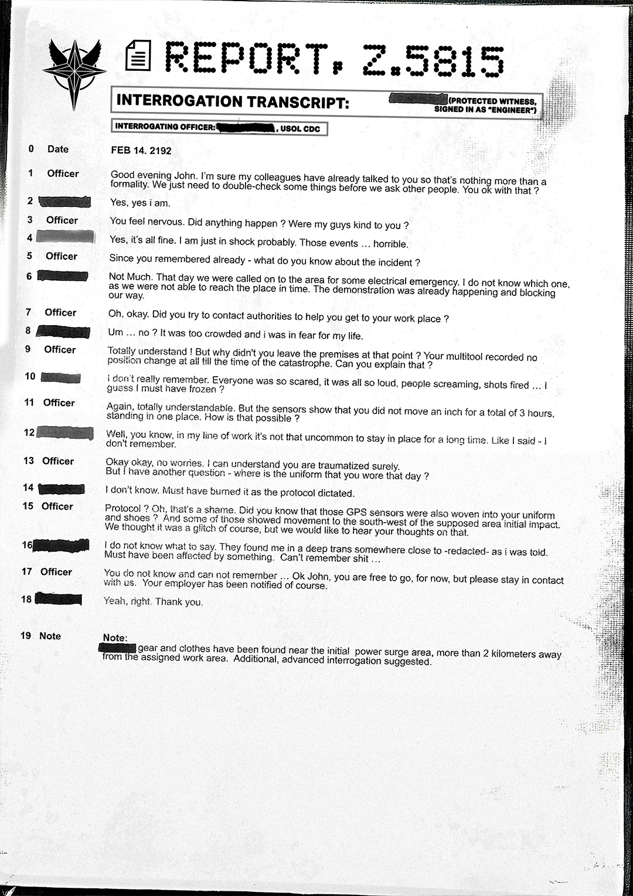

# 报告 Z（Report Z）

- 分类：Entry 1: The Contract
- 类型：IMAGE
- entryId：019d5d98-f5d1-7cb5-abc3-1b39f887831f
- 配图：../../img/B879A9F06F5B243F.jpg

---

## 图片文字（中文翻译）

> 由配图转录并翻译；原文为英文，专有名词保留原文拼写

**页眉**

- 左上：USOL 徽记
- 标题：REPORT Z-5815（报告 Z-5815）
- 副标题：INTERROGATION TRANSCRIPT（审讯记录）：[已涂黑]（PROTECTED WITNESS, SIGNED IN AS "ENGINEER"／受保护证人，以"工程师"署名）
- 审讯官（INTERROGATING OFFICER）：[已涂黑]，USOL CDC

**记录正文**

**0　Date（日期）**：FEB 14. 2192（2192 年 2 月 14 日）

**1　Officer（警官）**：晚上好，John。我相信我的同事已经跟你谈过了，所以这不过是走个形式。我们只是要在问其他人之前再核对一些事情。你没问题吧？

**2　[已涂黑]**：是的，是的，我是。

**3　Officer**：你看起来紧张。发生什么事了吗？我们的人对你还好吗？

**4　[已涂黑]**：是的，都还好。我只是大概受了惊吓。那些事……太可怕了。

**5　Officer**：既然你已经记起来了——你对那起事件知道些什么？

**6　[已涂黑]**：不多。那天我们因为某种电力紧急情况被叫到那片区域。我不知道是哪一个，因为我们没能及时赶到那里。示威已经在进行，挡住了我们的路。

**7　Officer**：哦，好吧。你有没有尝试联系当局，帮你到达你的工作地点？

**8　[已涂黑]**：嗯……没有？人太多了，而且我怕丢命。

**9　Officer**：完全理解！但那你为什么不在那个时刻离开现场？你的多功能工具（multitool）记录显示，在灾难发生的那一刻之前，你的位置完全没有变化。你能解释一下吗？

**10　[已涂黑]**：我真的不记得了。所有人都那么害怕，那么吵，人们在尖叫，枪声响起……我想我大概是僵住了？

**11　Officer**：再次，完全可以理解。但传感器显示你在三个小时里一动都没动，就站在一个地方。那怎么可能？

**12　[已涂黑]**：嗯，你知道，干我这行的，长时间待在原地并不算少见。就像我说的——我不记得了。

**13　Officer**：好吧好吧，别担心。我当然能理解你肯定受了创伤。但我还有一个问题——你那天穿的制服在哪里？

**14　[已涂黑]**：我不知道。肯定按协议烧掉了。

**15　Officer**：协议？哦，那可真遗憾。你知道那些 GPS 传感器也被织进了你的制服和鞋子里吗？而且其中一些显示，在所谓的冲击初始区域西南方向有移动。我们以为那是故障，但我们想听听你的看法。

**16　[已涂黑]**：我不知道该说什么。他们发现我处在某种深度恍惚状态，靠近——已涂黑——的地方，我是这么被告知的。肯定是被什么东西影响了。什么都记不起来……

**17　Officer**：你不知道，也记不起来……好吧 John，你现在可以走了，但请与我们保持联系。你的雇主当然已经收到通知了。

**18　[已涂黑]**：是啊，好吧。谢谢。

**19　Note（备注）**：备注：[已涂黑] 的装备和衣物在初始电涌区域附近被发现，距指定工作区域超过 2 公里。建议进行进一步的深入审讯。
