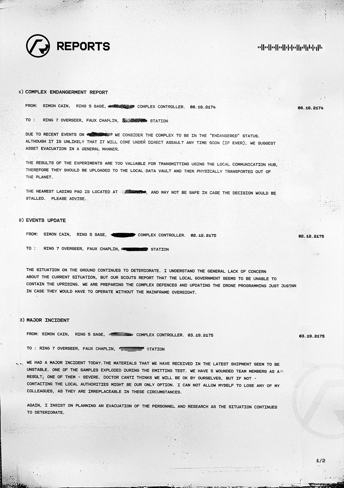

# 报告 1（Reports 1）

- 分类：Entry 1: The Contract
- 类型：IMAGE
- entryId：019d5d98-f5d1-7f21-96c6-c2f7cbb06527
- 配图：../../img/08D04A572AF69ACE.jpg

---

## 图片文字（中文翻译）

> 由配图转录并翻译；原文为英文，专有名词保留原文拼写

**页眉**

- 左上：REPORTS 徽标
- 右上：一段条形码状的信号波形图案

**1) COMPLEX ENDANGERMENT REPORT（综合设施危及报告）**

- 发件（FROM）：SIMON CAIN，RING 5 SAGE，[已涂黑] COMPLEX CONTROLLER（综合设施控制员）。08.16.2174　　（右侧日期：08.16.2174）
- 收件（TO）：RING 7 OVERSEER，FAUX CHAPLIN，[已涂黑] STATION

鉴于 [已涂黑] 上近期发生的事件，我们认为该综合设施处于"受威胁"（endangered）状态。尽管它不太可能在不久后遭到直接攻击（如果真的会的话），我们建议以全面方式撤离资产。

实验结果太过宝贵，不能通过本地通信枢纽传输，因此应上传至本地数据保险库，然后从该行星物理运出。

最近的着陆平台位于 [已涂黑]，若决定被拖延，该处可能也不安全。请指示。

**2) EVENTS UPDATE（事态更新）**

- 发件（FROM）：SIMON CAIN，RING 5 SAGE，[已涂黑] COMPLEX CONTROLLER。02.12.2175　　（右侧日期：02.12.2175）
- 收件（TO）：RING 7 OVERSEER，FAUX CHAPLIN，[已涂黑] STATION

地面局势持续恶化。我理解各方对当前局势普遍缺乏关注，但我们的侦察员报告说，当地政府似乎无法控制这场暴动。我们正在加强综合设施防御，并更新无人机程序（原文此处字迹残缺、[无法辨认]），以防它们必须在没有主机监督的情况下运作。

**3) MAJOR INCIDENT（重大事故）**

- 发件（FROM）：SIMON CAIN，RING 5 SAGE，[已涂黑] COMPLEX CONTROLLER。03.19.2175　　（右侧日期：03.19.2175）
- 收件（TO）：RING 7 OVERSEER，FAUX CHAPLIN，[已涂黑] STATION

今天我们发生了一起重大事故。我们最近一批货物中收到的材料似乎不稳定。其中一个样本在发射测试（emitting test）中爆炸了。我们有 5 名队员受伤，其中一人——重伤。Canti 医生认为我们能自行应付，但若非如此——联系当地政府可能是我们唯一的选择。我不能允许自己失去任何一位同事，因为在这种情况下他们是不可替代的。

我再次坚持，随着局势继续恶化，应着手规划人员和研究成果的撤离。

（页脚：1/2）
