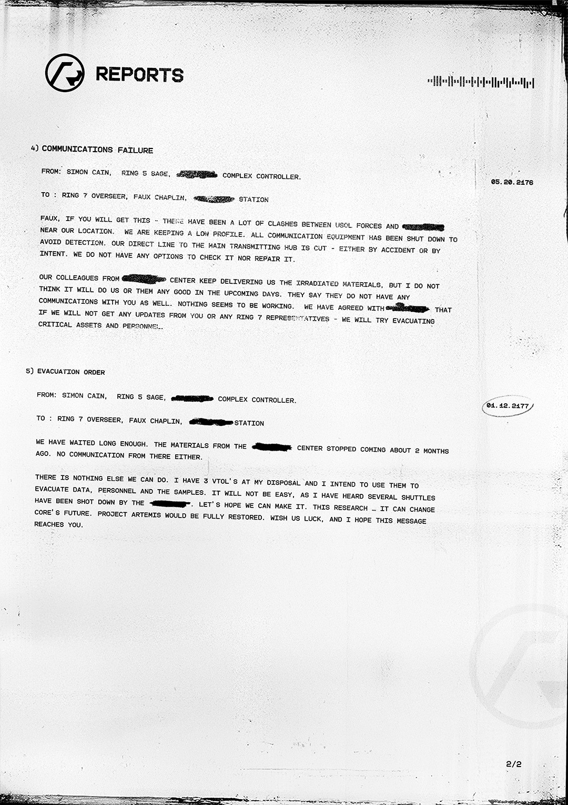

# 报告 2（Reports 2）

- 分类：Entry 1: The Contract
- 类型：IMAGE
- entryId：019d5d98-f5d1-7313-96c6-a55c9ac03c05
- 配图：../../img/FEE49FB066F1A5C4.png

---

## 图片文字（中文翻译）

> 由配图转录并翻译；原文为英文，专有名词保留原文拼写

**页眉**

- 左上：REPORTS 徽标
- 右上：一段条形码状的信号波形图案

**4) COMMUNICATIONS FAILURE（通信中断）**

- 发件（FROM）：SIMON CAIN，RING 5 SAGE，[已涂黑] COMPLEX CONTROLLER。
- 收件（TO）：RING 7 OVERSEER，FAUX CHAPLIN，[已涂黑] STATION
- 右侧日期：05.20.2176

FAUX，如果你能收到这条消息——我们所在地附近，USOL 部队与 [已涂黑] 之间发生了大量冲突。我们正在保持低调。所有通信设备都已关闭以避免被发现。我们通往主传输枢纽的直连线被切断了——无论是意外还是有意为之。我们没有任何办法去检查或修复它。

我们来自 [已涂黑] 中心的同事一直在给我们送来辐照材料，但我不认为在接下来的日子里这对我们或他们会有任何好处。他们说他们也与你没有任何通信。似乎什么都不管用。我们已与 [已涂黑] 商定，如果我们无法从你或环 7 的任何代表那里得到任何消息——我们将尝试撤离关键资产和人员。

**5) EVACUATION ORDER（撤离命令）**

- 发件（FROM）：SIMON CAIN，RING 5 SAGE，[已涂黑] COMPLEX CONTROLLER。
- 收件（TO）：RING 7 OVERSEER，FAUX CHAPLIN，[已涂黑] STATION
- 右侧日期：04.12.2177

我们已经等得够久了。来自 [已涂黑] 中心的材料大约两个月前就停止送来了。那里也没有任何通信。

我们别无他法。我手上有 3 艘 VTOL，我打算用它们撤离数据、人员和样本。这不会容易，因为我听说已有数艘穿梭机被 [已涂黑] 击落。希望我们能成功。这项研究……它能改变 CORE 的未来。阿尔忒弥斯计划将被完全恢复。祝我们好运，希望这条消息能送达你。

（页脚：2/2）
