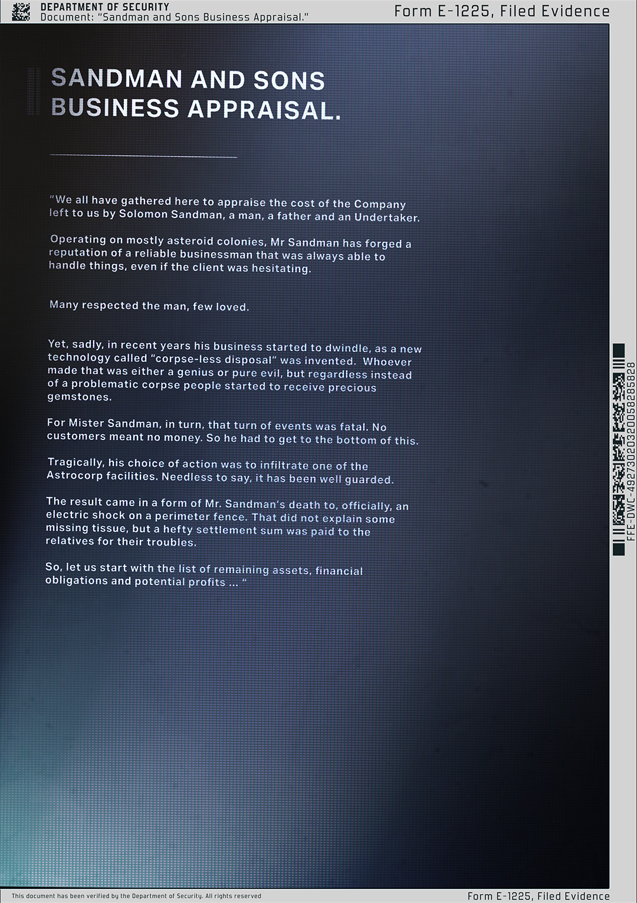

# 桑德曼父子公司（Sandman & Sons）

- 分类：Entry 1: The Contract
- 类型：IMAGE
- entryId：019d5d98-f5d1-7756-b8a0-448c82db2b7e
- 配图：../../img/6B14BF14675E6BED.jpg

---

## 图片文字（中文翻译）

> 由配图转录并翻译；原文为英文，专有名词保留原文拼写

**页眉条**

- 左：DEPARTMENT OF SECURITY（安全部）／Document: "Sandman and Sons Business Appraisal."（文件："桑德曼父子业务评估"）
- 右：Form E-1225, Filed Evidence（表格 E-1225，归档证据）

**标题**：SANDMAN AND SONS BUSINESS APPRAISAL.（桑德曼父子业务评估）

**正文**

「我们聚集于此，是为了评估所罗门·桑德曼（Solomon Sandman）留给我们的这家公司的价值——他是一个男人、一位父亲，也是一名殡葬业者（Undertaker）。

桑德曼先生主要在小行星殖民地经营，凭可靠商人的名声立足，总能搞定事情，即便客户犹豫不决。

许多人敬重他，少数人爱戴他。

然而遗憾的是，近些年他的生意开始萎缩，因为一项名为"无尸处理"（corpse-less disposal）的新技术被发明出来。发明者要么是个天才，要么是纯粹的邪恶；但无论如何，人们不再收到麻烦的尸体，而是收到珍贵的宝石。

对桑德曼先生而言，这一变化是致命的。没有客户就没有钱。所以他必须查清此事。

悲剧的是，他选择的行动是潜入 Astrocrop 的一处设施。不用说，那里戒备森严。

结果就是桑德曼先生的死讯，官方说法是：在周界围栏上触电身亡。这并不能解释某些失踪的组织，但一笔可观的赔偿金已支付给他的亲属，以了结麻烦。

那么，让我们从剩余资产、财务义务和潜在收益的清单开始吧……」

**侧边条码文字**：FEE-DWC-4929473-8D1E-20B3283258

**页脚**：This document has been verified by the Department of Security. All rights reserved.（本文件已由安全部核验。保留所有权利。）／Form E-1225, Filed Evidence
