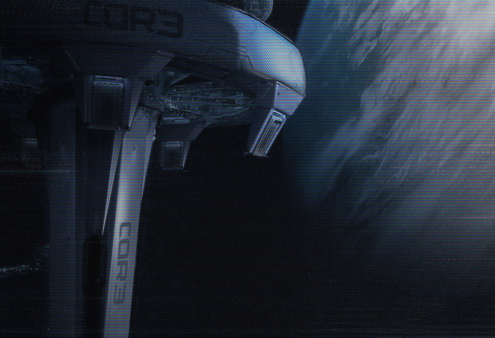

# 天梯照片（Skylift Photo）

- 分类：Entry 1: The Contract
- 类型：IMAGE
- entryId：019d5d98-f5d1-78f9-8eb7-3865639c74a4
- 配图：../../img/0CF7A5F0D850DEEB.jpg

---

## 图片说明

一张仰拍照片：画面主体是一艘 CORE 载具／平台的下部结构，机身与起落支柱上可见 CORE 标志与字样，右侧是天梯（Skylift）的巨大斜向塔体结构，整体呈冷蓝色调，没有其他可读文字。
