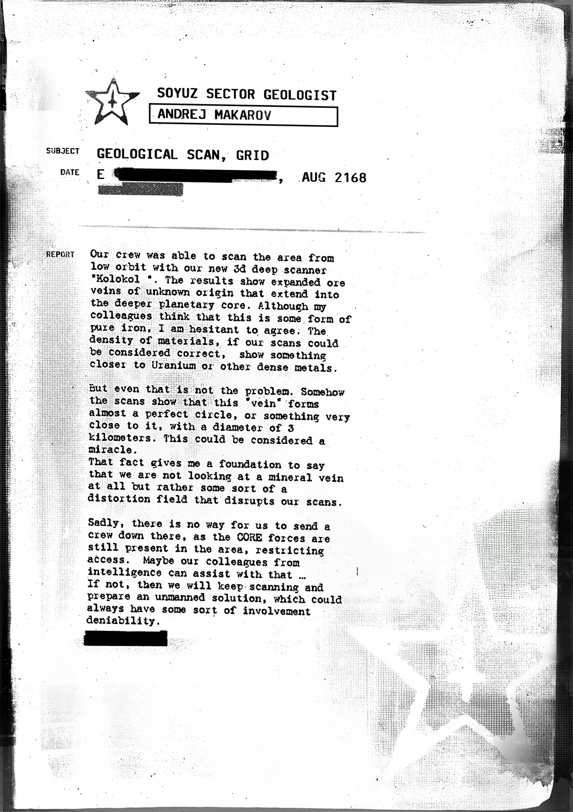

# 联盟号地质扫描报告——科洛科尔场址（Soyuz Geological Scan Report — Kolokol Site）

- 分类：Entry 1: The Contract
- 类型：IMAGE
- entryId：019d5d98-f5d1-7739-acb4-5a146d78097a
- 配图：../../img/2722729646057593.jpg

---

## 图片文字（中文翻译）

> 由配图转录并翻译；原文为英文，专有名词保留原文拼写

**页眉**

- 左上：带星徽的印章图案
- 抬头：SOYUZ SECTOR GEOLOGIST（联盟扇区地质学家）
- 姓名框：ANDREJ MAKAROV
- 主题（SUBJECT）：GEOLOGICAL SCAN, GRID（地质扫描，网格）
- 日期（DATE）：E [已涂黑]，AUG 2168（2168 年 8 月）

**报告（REPORT）**

我们的船员得以用新的 3D 深部扫描仪从低轨道扫描该区域，其代号为"Kolokol"。结果显示有扩张的矿脉，来源不明，延伸至行星更深处的地核。尽管我的同事认为这是某种纯铁，但我不太愿意同意。如果我们的扫描可以被认为正确，材料的密度显示它更接近铀或其他重质金属。

但即便如此，这也不是问题所在。不知何故，扫描显示这条"矿脉"几乎形成一个完美的圆形——或者说非常接近圆形——直径 3 公里。这可以算是个奇迹。
这一事实让我有依据说：我们看到的根本不是矿脉，而是某种干扰我们扫描的畸变场（distortion field）。

遗憾的是，我们没有办法派一支队伍下去，因为 CORE 部队仍在该区域，限制进入。也许我们情报部门的同事能帮上忙……
如果不行，那我们就继续扫描，并准备一个无人方案，那样总能保留某种程度的可否认性。
