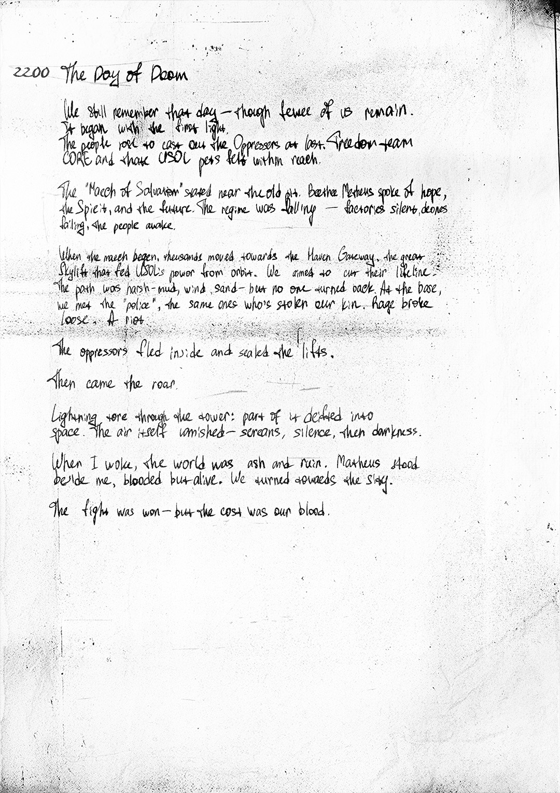

# 末日之日（The Day of Doom）

- 分类：Entry 1: The Contract
- 类型：IMAGE
- entryId：019d5d98-f5d1-75b1-b691-ca5988819833
- 配图：../../img/A66743F4B201B9FF.jpg

---

## 图片文字（中文翻译）

> 由配图转录并翻译；原文为英文，专有名词保留原文拼写

（手写笔记，字迹潦草处标注为 [无法辨认]）

**2200　The Day of Doom（末日之日）**

我们仍记得那一天——尽管我们中剩下的人已经不多了。
它始于第一道光。
人民奋起，终于要赶走压迫者。自由之队（Freedom Team）的 CORE，以及那些 USOL 害虫，都近在咫尺。

"救赎进军"（March of Salvation）在老矿坑附近开始。Mathews 兄弟谈到了希望、圣灵与未来。政权正在动摇——他们的静默无人机失灵了，人民醒了。

进军开始时，成千上万的人涌向天堂之门（Haven Gateway），那是从轨道上喂养 USOL 权力的巨大天梯。我们武装起来，要切断他们的生命线。道路是泥浆、风沙——但没有人回头。在基地，我们遇上了"警察"，正是那些偷走我们亲人的人。混乱爆发了。一场暴动。

压迫者逃进内部，封锁了升降机。

然后，轰鸣来了。

闪电穿过塔身：它的一部分折入了太空。空气本身被震碎——尖叫、寂静，然后是黑暗。

当我醒来时，世界已成灰烬与废墟。Mathews 兄弟躺在我身旁，浑身是血但还活着。我们转向天空。

战斗胜利了——但代价是我们的血。
