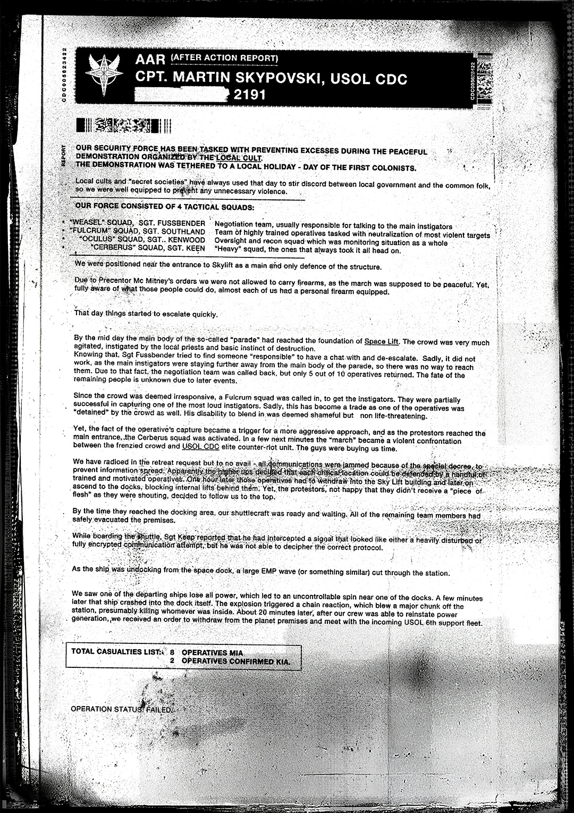

# USOL 行动后报告（USOL AAR Report）

- 分类：Entry 1: The Contract
- 类型：IMAGE
- entryId：019d5d98-f5d1-7c26-9e29-9bd363145668
- 配图：../../img/08A40FA37F915147.png

---

## 图片文字（中文翻译）

> 由配图转录并翻译；原文为英文，专有名词保留原文拼写

**页眉**

- 左：USOL 徽记
- 标题：AAR (AFTER ACTION REPORT)（行动后报告）
- 副标题：CPT. MARTIN SKYPOVSKI, USOL CDC（上尉 Martin Skypovski，USOL CDC）
- 日期行：[已涂黑] 2191
- 两侧条码文字：左 01090 832132；右 C0000239

**正文**

我们的安全部队受命在本地邪教组织举行的和平示威期间防止过激行为。
该示威与一个地方节日挂钩——"首批殖民者日"（DAY OF THE FIRST COLONISTS）。

本地邪教与"秘密社团"一向利用这一天在地方政府与平民之间挑动纷争，因此我们装备齐全，以防任何不必要的暴力。

**我方部队由 4 个战术小队组成：**

- "WEASEL"（黄鼠狼）小队，SGT. FUSSBENDER
- "FULCRUM"（支点）小队，SGT. SOUTHLAND——谈判小组，通常负责与主要煽动者对话
- "OCULUS"（眼）小队，SGT. KENWOOD——由训练有素的行动人员组成的队伍，负责清除最暴力的目标
- "CERBERUS"（刻耳柏洛斯）小队，SGT. KEEN——监视与侦察小队，负责整体监控局势

我们驻扎在 Skylift 入口附近，作为主要也是唯一的防线。

由于 Precentor Mc Mitney 的命令，我们不被允许携带枪械，因为游行本应是和平的。然而，我们完全清楚那些人会做出什么，几乎我们每个人身上都配了私人枪械。

那天，事态开始迅速升级。

到正午时分，所谓"游行"的主体已经抵达 Space Lift 的地基。人群非常激动，受到本地祭司与基本破坏本能的煽动。
知道这一点后，Sgt. Fussbender 试图找一位"负责人"谈一谈、缓和局势。遗憾的是没有成功，因为主要煽动者都待在离游行主体更远的地方，所以根本无从接触到他们。因此，谈判小组被召回，但 10 名行动人员中只有 5 人返回。其余人员的下落因后来发生的事件而不明。

由于人群被认为不理会劝告，一个 Fulcrum 小队被调来抓捕煽动者。他们部分成功地抓获了其中一名最响亮的煽动者。遗憾的是，这变成了一笔交易：一名行动人员也被人群"扣留"了。他无法混入人群这一点被视为耻辱，但并不危及生命。

然而，这名行动人员被抓一事成了更激进做法的导火索；当抗议者抵达主入口时，Cerberus 小队被启动。几分钟之内，"游行"就变成了狂暴人群与 USOL CDC 精英反暴乱部队之间的暴力对抗。那些家伙是在为我们争取时间。

我们在撤退请求中呼叫了支援，但没有回应——所有通信都被特别法令干扰，以防止信息扩散。显然，暴乱者已经预料到了这一点。任何正式行动都可能是灾难性的。一小队训练有素、积极性高的行动人员。我们的一队人马不得不撤入 Sky Lift 建筑，随后登上码头，把内部通道封锁在他们身后。然而，抗议者们并不高兴没能分到"一杯羹"，于是高喊着"鲜肉"决定跟着我们上到顶部。

等他们到达码头区域时，我们的穿梭机已经准备好并等候着。所有剩余的队员都已安全撤离了设施。

在登上穿梭机时，Sgt. Keen 报告说，他截获了一个信号，看起来像是被严重干扰、或完全加密的通信尝试；但他无法破译正确的协议。

就在飞船从太空码头解缆时，一道巨大的 EMP 波（或类似的东西）贯穿了整个空间站。

我们看到一艘正在离去的飞船失去全部动力，在码头附近失控旋转。几分钟后，那艘飞船撞上了码头本身。爆炸引发了连锁反应，炸掉了空间站的一大块，大概杀死了里面的所有人。大约 20 分钟后，在我们的人员得以恢复供电之后，我们收到命令：撤出该行星范围，与前来接应的 USOL 第 6 支援舰队会合。

**总伤亡名单（TOTAL CASUALTIES LIST）：**

- 8 名行动人员失踪（OPERATIVES MIA）
- 2 名行动人员确认阵亡（OPERATIVES CONFIRMED KIA）

**行动状态（OPERATION STATUS）：失败（FAILED）**
