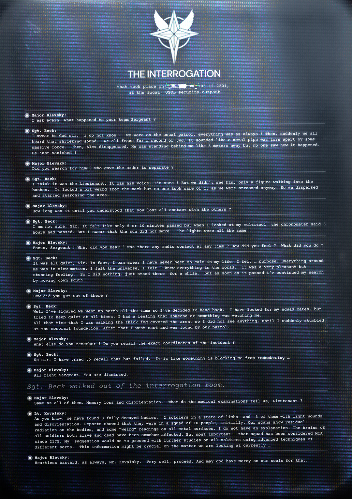

# USOL 审讯报告——贝克中士事件（USOL Interrogation Report — Sgt. Beck Incident）

- 分类：Entry 1: The Contract
- 类型：IMAGE
- entryId：019d5d98-f5d0-77f9-893b-e81e0bc41e73
- 配图：../../img/85A93C106F293611.png

---

## 图片文字（中文翻译）

> 由配图转录并翻译；原文为英文，专有名词保留原文拼写

**标题**

- 顶部：USOL 徽记
- THE INTERROGATION（审讯）
- 小字：that took place on [已涂黑] 05.12.2201, at the local USOL security outpost（发生于 [已涂黑] 05.12.2201，地点为当地 USOL 安全哨所）

**记录正文**

**Major Blevsky（Blevsky 少校）**：我再问一次，你的小队到底出了什么事，中士？

**Sgt. Beck（Beck 中士）**：我向上帝发誓，长官，我真的不知道！我们当时在执行常规巡逻，一切都和往常一样！然后，突然，我们全都听到一阵刺耳的响声。我们都僵住了一两秒。那声音听起来像是一根金属管被某种巨大的力量撕开。然后，Alex 就不见了。他当时就站在我身后大约 5 米的地方，但没人看见那是怎么发生的。他就那么消失了！

**Major Blevsky**：你们找过他吗？是谁下令分开搜索的？

**Sgt. Beck**：我想是少尉。是他的声音，我确定！但我们没看到他，只看到一个身影走进了灌木丛。从背后看有点奇怪，但因为当时我们都很紧张，没人当回事。于是我们散开，开始搜索该区域。

**Major Blevsky**：过了多久你才意识到你们和其他人全部失去了联系？

**Sgt. Beck**：我不确定，长官。感觉只过了 5 到 10 分钟，但当我看向多功能工具上的计时器时，它显示已经过去了 3 个小时。但我发誓太阳根本没有移动！光线完全一样！

**Major Blevsky**：集中精神，中士！你听到了什么？当时有任何无线电联络吗？你感觉如何？你做了什么？

**Sgt. Beck**：一切都很安静，长官。事实上，我可以发誓我一生中从未如此平静过。我感觉……有目的。周围的一切都在慢动作中。我感受到了宇宙，我感觉自己知道世上的一切。那是一种非常愉悦、却又令人震撼的感觉。所以我什么也没做，只是在那里站了一会儿；但等它过去，我就继续向南搜索。

**Major Blevsky**：你是怎么从那里出来的？

**Sgt. Beck**：嗯，我推断我们一直是在往北走，所以我决定往回走。我找过我的队友，但一直尽量保持安静。我有个感觉，有什么人或者什么东西在盯着我。
那段时间我一直在走，浓雾覆盖了整个区域，所以我什么也看不见，直到我突然绊倒在单轨铁路的基座（monorail foundation）上。之后我往东走，被我们的巡逻队找到了。

**Major Blevsky**：你还记得什么？你记得事件的确切坐标吗？

**Sgt. Beck**：不，长官。我试过回忆，但失败了。就好像有什么东西在阻止我记起来……

**Major Blevsky**：好吧，中士。你可以走了。

*Sgt. Beck 走出了审讯室。*

**Major Blevsky**：和其他所有人一样。记忆缺失与定向障碍。医疗检查告诉我们什么，少尉？

**Lt. Kovalsky（Kovalsky 少尉）**：如你所知，我们发现了 3 具高度腐烂的尸体，2 名士兵处于僵滞状态，另有 3 人有轻伤和定向障碍。报告显示他们原本是一个 10 人小队，最初是这样。我们的扫描显示尸体上有残留辐射，所有金属表面也有一些"怪异"读数。我无法解释。所有士兵——无论生死——的大脑都受到了某种影响。但最重要的是……这个小队自 2175 年起就被列为失踪（MIA）。我的建议是继续对所有士兵使用不同类型的先进技术做进一步研究。这条信息对我们目前正在调查的事情可能至关重要……

**Major Blevsky**：冷血混蛋，一如既往，Kovalsky 先生。很好，继续。愿上帝怜悯我们的灵魂。
