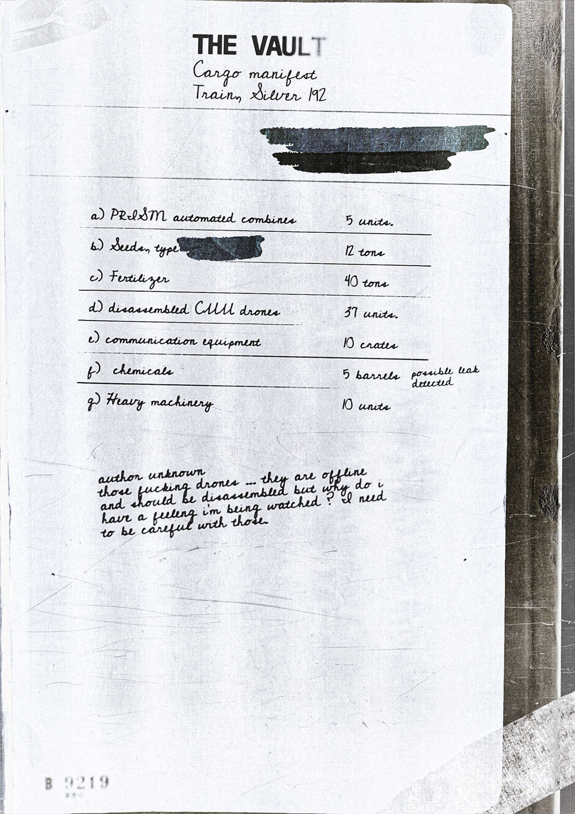

# 金库货运清单——银色 192 列车（Vault Cargo Manifest — Silver 192 Train）

- 分类：Entry 1: The Contract
- 类型：IMAGE
- entryId：019d5d98-f5d1-75d2-b1b9-5ef0a7d14ef3
- 配图：../../img/96CC77482E51D12A.jpg

---

## 图片文字（中文翻译）

> 由配图转录并翻译；原文为英文，专有名词保留原文拼写

**标题区**

- THE VAULT（金库）
- Cargo manifest（货物清单）
- Train "Silver 192"（列车"银色 192"）
- 标题下方有一处 [已涂黑] 的横向涂黑区域

**清单**

| 编号 | 项目 | 数量 |
| --- | --- | --- |
| a) | PROSIM automated combines（PROSIM 自动联合收割机） | 5 units（5 台） |
| b) | Seeds, type [已涂黑]（种子，型号 [已涂黑]） | 12 tons（12 吨） |
| c) | Fertilizer（肥料） | 40 tons（40 吨） |
| d) | disassembled CMM drones（拆解的 CMM 无人机） | 37 units（37 台） |
| e) | communication equipment（通信设备） | 10 crates（10 箱） |
| f) | chemicals（化学品） | 5 barrels（5 桶），旁注：possible leak detected（检测到可能泄漏） |
| g) | Heavy machinery（重型机械） | 10 units（10 台） |

**手写批注（标注：autor unknown／作者不明）**

「那些该死的无人机……它们已经离线，本应被拆解，但为什么我总觉得有人在监视我？我得小心处理这些家伙。」

**左下角钢印编号**：B 9219
