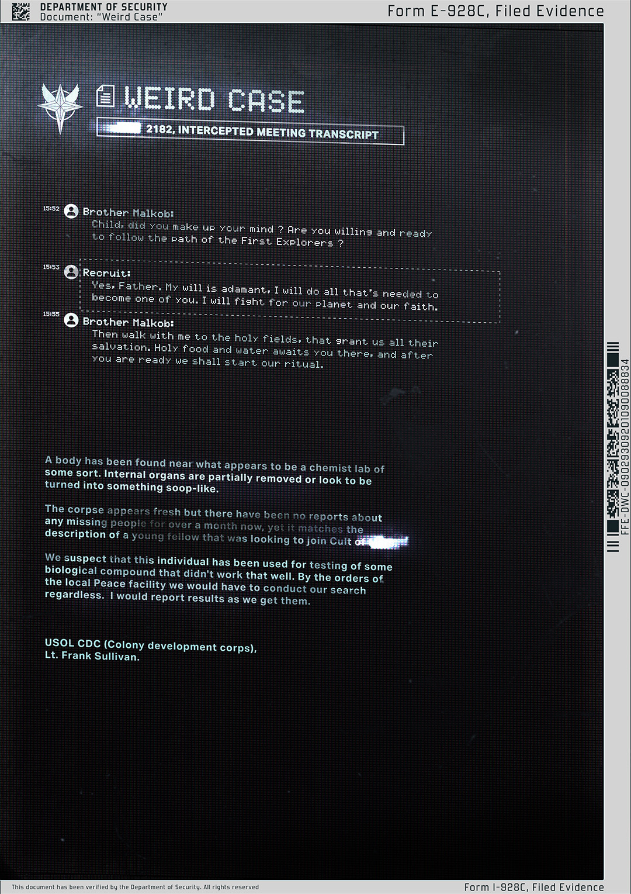

# 怪案（Weird Case）

- 分类：Entry 1: The Contract
- 类型：IMAGE
- entryId：019d5d98-f5d1-76c4-8ba0-5254687a3065
- 配图：../../img/0679737586435306.jpg

---

## 图片文字（中文翻译）

> 由配图转录并翻译；原文为英文，专有名词保留原文拼写

**页眉条**

- 左：DEPARTMENT OF SECURITY（安全部）／Document: "Weird Case"（文件："怪案"）
- 右：Form I-928C, Filed Evidence（表格 I-928C，归档证据）

**标题**：WEIRD CASE（怪案）

**副标题**：[已涂黑] 2182, INTERCEPTED MEETING TRANSCRIPT（2182 年，截获的会面记录）

**记录正文**

**15:52　Brother Malkob（Malkob 兄弟）**：孩子，你下定决心了吗？你是否愿意并且准备好走上第一探索者（First Explorers）之路？

**15:53　Recruit（招募对象）**：是的，父亲。我的意志是坚定的。我会做一切必要之事，成为你们中的一员。我会为我们的行星和我们的信仰而战。

**15:55　Brother Malkob**：那就随我走到圣田去，那里赐予我们所有人救赎。圣食与圣水在那里等着你，等你准备好，我们就开始仪式。

**（下方调查报告）**

一具尸体在看起来像某种化学实验室的地方附近被发现。内脏被部分摘除，或者看起来被变成了某种糊状物。

尸体看起来很新鲜，但一个多月来没有任何失踪人口的报告；然而它符合一名想加入 [已涂黑] 教派的年轻人的描述。

我们怀疑此人被用于测试某种效果不太好的生物化合物。奉当地和平机构（Peace facility）之命，无论如何我们都要进行搜查。有结果我会随时汇报。

USOL CDC（Colony development corps／殖民地开发军团）
Lt. Frank Sullivan（Frank Sullivan 少尉）

**侧边条码文字**：FEE-DWC-03059-0A5E-09E8C0C8C3F04

**页脚**：This document has been verified by the Department of Security. All rights reserved.（本文件已由安全部核验。保留所有权利。）／Form I-928C, Filed Evidence
