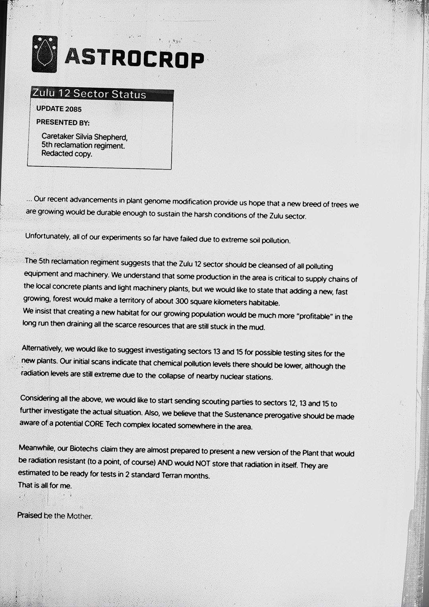

# Zulu-12 星区（Zulu-12 Sector）

- 分类：Entry 1: The Contract
- 类型：IMAGE
- entryId：019d5d98-f5d1-78a8-8dfd-f59139dce409
- 配图：../../img/348C07C70B108E4B.jpg

---

## 图片文字（中文翻译）

> 由配图转录并翻译；原文为英文，专有名词保留原文拼写

**页眉**

- 左上：ASTROCROP 徽标（水滴形图案）与字样
- 标题框：Zulu 12 Sector Status（Zulu 12 扇区状况）
- UPDATE 2085（2085 年更新）
- 提交人（PRESENTED BY）：Caretaker Silvia Shepherd，5th reclamation regiment. Redacted copy.（管理员 Silvia Shepherd，第 5 复垦团。删节本）

**正文**

……我们在植物基因组改造方面的最新进展给了我们希望：我们正在培育的一种新树种，将足够耐用以承受 Zulu 扇区的严酷条件。

不幸的是，到目前为止我们所有的实验都因极端的土壤污染而失败。

第 5 复垦团建议，Zulu 12 扇区应清除所有造成污染的设备和机械。我们理解该区域的某些生产对当地混凝土厂和轻机械厂的供应链至关重要，但我们想指出，增加一片新的、快速生长的森林，将使约 300 平方公里的领土变得宜居。
我们坚持认为，为我们不断增长的人口创造新的栖息地，从长远来看，比耗尽所有仍陷在泥里的稀缺资源要"划算"得多。

另外，我们想建议考察 13 号和 15 号扇区，作为新植物的可能试验地点。我们的初步扫描表明，那里的化学污染水平应该更低，不过由于附近核电站的坍塌，辐射水平仍然极高。

鉴于以上所有情况，我们想开始向 12、13 和 15 号扇区派出侦察队，进一步调查实际情况。此外，我们认为应让 Sustenance 特权方（Sustenance prerogative）知晓该区域某处可能存在一个 CORE Tech 综合设施。

与此同时，我们的生物技术团队声称，他们几乎准备好展示一种新版本的植物，它将具备抗辐射能力（当然，到某种程度），并且不会把辐射储存在自身内。预计在两个标准 Terran 月后可以测试。
我要说的就这些。

赞美母亲（Praised be the Mother）。
