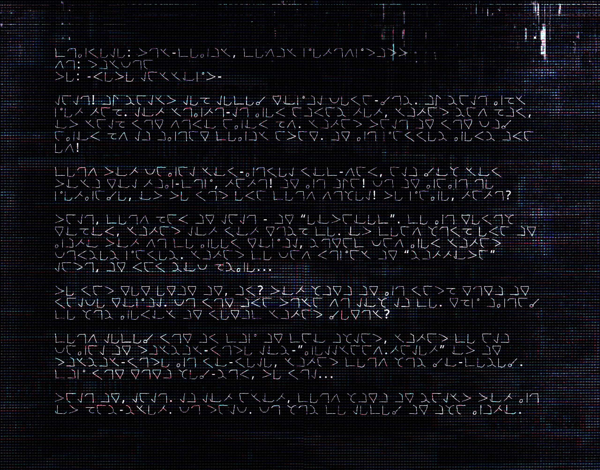

# 5CRYPt0L (3)

- 分类：Entry 2: The Journey
- 类型：IMAGE
- entryId：019d5d98-f5d1-70fb-81f3-cdeb40b7f4ec
- 配图：../../img/BD1F73BDCF0A353F.png

---

## 图片文字（中文翻译）

> 由配图转录并翻译；原文为英文，专有名词保留原文拼写

[无法辨认]

配图是一屏黑底、覆有彩色噪点与横向扫描线的文本界面，其上排布着多段左右对齐的文本块。这些字符是一套自造的虚构符号字体（由尖角、圆圈、短横与点组合而成），既不是拉丁字母、西里尔字母，也不是任何可对照的现行文字，因此无法逐字转写、无法辨读词句；只能看出它是一段分段排列的连续文本，其中含带引号的片段以及问号、感叹号等标点。
