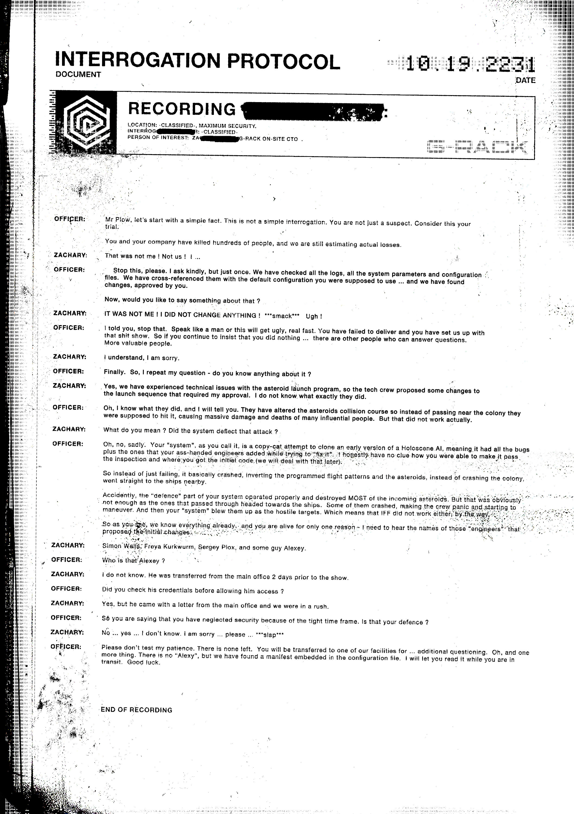

# 审问规程（Interrogation Protocol）

- 分类：Entry 2: The Journey
- 类型：IMAGE
- entryId：019d5d98-f5d1-7e7e-93f2-1ab49d251875
- 配图：../../img/8968801BCBA2EC31.jpg

---

## 图片文字（中文翻译）

> 由配图转录并翻译；原文为英文，专有名词保留原文拼写

**文件抬头**

- 文件类型：审问规程（INTERROGATION PROTOCOL / DOCUMENT）
- 日期：10.19.2231
- 录音（RECORDING）：[被涂黑]
- 地点：机密，最高安全级别
- 审讯员：机密
- 相关人员：ZA[被涂黑] —— G-RACK 现场首席技术官（ON-SITE CTO）
- 抬头右侧与框内右下角有 G-RACK 的方块状标识

**正文（审讯对话转录）**

审讯官：普劳先生（Mr Plow），我们从一个简单的事实开始。这不是一次普通的审讯。你不仅仅是嫌疑人。把这当成对你的审判吧。

你和你的公司害死了数百人，而我们还在估算实际的死亡数字。

扎卡里：那不是我！不是我们！我……

审讯官：请停下。我客气地请求，但只说一次。我们查过了所有日志、所有系统参数和配置文件。我们把它们与你们本该使用的默认配置做了交叉比对……然后发现了改动，而且是你批准的改动。

那么，你想对此说点什么吗？

扎卡里：不是我！我什么都没改！***啪*** 呃！

审讯官：我说了，停下。像个男人一样说话，否则事情会很快变得很难看。你没有完成任务，还让我们陷进那场烂摊子。所以如果你继续坚持说你什么都没做……还有别人能回答问题。更有价值的人。

扎卡里：我明白，对不起。

审讯官：总算。那我重复我的问题——你对此知道些什么？

扎卡里：知道，我们的陨石发射程序出了技术问题，所以技术组提出了对发射序列的一些改动，需要我批准。他们具体做了什么，我不知道。

审讯官：哦，我知道他们做了什么，我告诉你。他们改动了陨石的碰撞轨道，这些陨石本该从殖民地附近掠过，结果却撞了上去，造成大规模破坏和许多有影响力的人死亡。不过实际上那并没有成功。

扎卡里：您是什么意思？系统把那次攻击偏转掉了？

审讯官：哦，不，很遗憾。你们所谓的"系统"，是一次照猫画虎的复制，目的是克隆一个早期版本的 Holoscene AI，这意味着它带着原有的全部缺陷，再加上你们那些笨手笨脚的工程师在"修它"时添上的新缺陷。说实话我完全不明白你们怎么让它通过了检查，也不知道你们最初那份代码是从哪儿弄来的（这个我们稍后再算账）。

所以它不只是失灵，而是直接崩溃，把编程好的飞行模式整个反转，于是那些陨石没有撞向殖民地，而是直奔附近的飞船。

"意外"的是，你们系统的"防御"部分运转正常，摧毁了大部分来袭陨石。但那显然不够，因为穿过去的那些继续朝飞船飞去。有几块撞了上去，船员惊慌失措，开始机动规避。然后你们的"系统"就把它们当成敌对目标打爆了。也就是说，敌我识别（IFF）同样没起作用。顺带说一句——

所以你看，我们早就全都知道了，你之所以还活着只有一个原因——我要听那几个提出最初改动的"工程师"的名字。

扎卡里：西蒙·瓦尔伊斯（Simon Waljs）、弗蕾娅·库克伍姆（Freya Kurkwurm）、谢尔盖·普洛克斯（Sergey Plox），还有个叫阿列克谢（Alexey）的家伙。

审讯官：这个阿列克谢是谁？

扎卡里：我不知道。他是在演示前两天从总部调过来的。

审讯官：你在准他进来之前核查过他的资历吗？

扎卡里：核查过，但他带着总部的一封信，而我们当时很赶时间。

审讯官：所以你是说，因为时间紧迫，你们就忽略了安全审查。这就是你的辩护？

扎卡里：不……是……我不知道。对不起……求您……***耳光***

审讯官：别考验我的耐心。已经没有耐心了。你会被转到我们的某个设施去，接受……进一步问话。哦，还有一件事。根本不存在"阿列克谢"这个人，但我们在一份配置文件里发现了一份嵌入的传送清单（manifest）。转运途中我会让你读一读。祝你好运。

**END OF RECORDING —— 录音结束**
