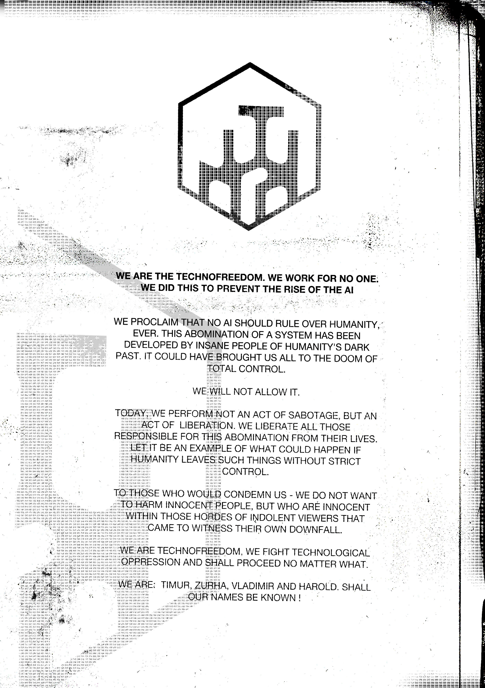

# 传送清单：Technofreedom（Manifest: Technofreedom）

- 分类：Entry 2: The Journey
- 类型：IMAGE
- entryId：019d5d98-f5d1-7fba-9e0d-bc08d40309c6
- 配图：../../img/452032DD18DE96FF.jpg

---

## 图片文字（中文翻译）

> 由配图转录并翻译；原文为英文，专有名词保留原文拼写

（页面上半部为组织标识：六边形边框内一个由粗线条构成的抽象字母组合；下方为下述宣言，纸面有大量污渍、涂改与撕裂痕迹，左侧透出一片密集印刷小字的底影。）

我们是技术自由（Technofreedom）。我们不为任何人效力。我们这么做，是为了阻止 AI 的崛起。

我们宣告：任何 AI 都不应统治人类，永远不应。这个系统是个怪物，出自人类黑暗过去中那些疯狂之人之手。它本可以把我们所有人带向全面控制的毁灭。

我们不会允许这种事发生。

今天，我们做的不是破坏行动，而是解放行动。我们把所有对这只怪物负有责任的人，从他们的生命中"解放"出来。让这件事成为一个例子，让世人看看：如果人类让这类东西不受严格管控，会发生什么。

致那些要谴责我们的人——我们不想伤害无辜者，可是在那些成群结队、懒洋洋地跑来看自己毁灭的看客里，谁又是无辜的？

我们是技术自由，我们对抗技术压迫，无论发生什么都会继续下去。

我们是：Timur、Zurha、Vladimir 和 Harold。愿我们的名字为人所知！
