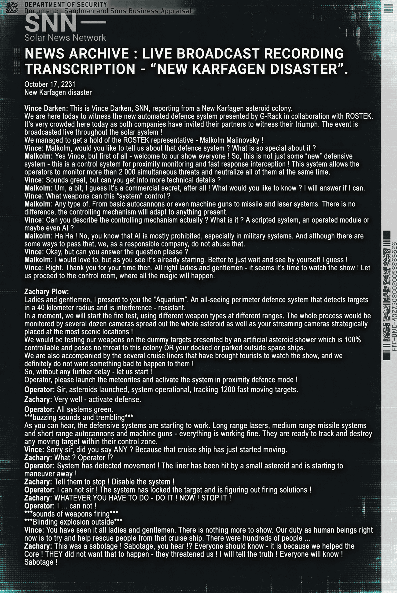

# 新卡尔法根灾难（New Karfagen Disaster）

- 分类：Entry 2: The Journey
- 类型：IMAGE
- entryId：019d5d98-f5d1-78a6-bbec-67d212dc2a0a
- 配图：../../img/0E54AB233B6216CB.png

---

## 图片文字（中文翻译）

> 由配图转录并翻译；原文为英文，专有名词保留原文拼写

**页面元素**

- 顶部：安全部（DEPARTMENT OF SECURITY）文件，"Sandman and Sons 商业评估"字样
- 台标：SNN —— Solar News Network（太阳系新闻网）
- 标题：新闻档案：直播录像转录——"新卡尔法根灾难"
- 日期：2231 年 10 月 17 日；新卡尔法根灾难

**正文（直播转录）**

Vince Darken：我是 Vince Darken，SNN，正在新卡尔法根（New Karfagen）小行星殖民地为您报道。

今天我们在这里见证 G-Rack 与 ROSTEK 合作推出的新型自动化防御系统。现场人山人海，两家公司都邀请了合作伙伴来见证他们的胜利。这场活动正在向全太阳系直播！

我们设法请到了 ROSTEK 的代表——Malcolm Malinovsky！

Vince：Malcolm，能给我们讲讲这套防御系统吗？它有什么特别之处？

Malcolm：好的，Vince，但首先——欢迎大家！那么，这不只是一套"新"防御系统——它是一个用于近距离监测与快速反应拦截的控制系统！这套系统让操作员可以同时监测超过 2000 个威胁，并把它们全部同时中和。

Vince：听起来不错，但能讲些更技术性的细节吗？

Malcolm：嗯，有一点，我猜这算是商业机密，毕竟！你想知道什么？能答的我就答。

Vince：这套"系统"能控制哪些武器？

Malcolm：任何类型。从基本的自动机炮乃至机枪，到导弹和激光系统，都一样。控制机制能适配现有的任何东西。

Vince：那您能描述一下控制机制本身吗？它到底是什么？脚本化系统、受控模块，还是甚至是 AI？

Malcolm：哈哈！不，你知道 AI 基本是被禁止的，尤其是在军事系统里。虽然确实有些办法能绕过去，但我们是一家负责任的公司，不会那么做。

Vince：好吧，但您能回答这个问题吗，拜托？

Malcolm：我很乐意，可你看，它马上就要开始了。最好还是自己看吧，我想！

Vince：好。那谢谢您抽时间。各位女士先生——看来该看演出了！让我们前往控制室，好戏将在那里上演。

Zachary Plow：

女士们先生们，我向你们展示"水族馆"（Aquarium）。一套全视角的周界防御系统，能在 40 公里半径内探测目标，并且抗干扰。

马上，我们就要开始实弹测试，在不同距离上使用不同类型的武器。整个过程将由分布在整个小行星上、位于风景最佳位置的几十台摄像机，以及你们精心选点布置的直播摄像机共同监控！

我们将用人工陨石雨生成的假目标来测试武器——这些陨石 100% 可控，对殖民地，或对你们停靠、停放的外部飞船，都不构成威胁。

同行的还有几艘载着游客来看表演的游轮，我们绝对不希望他们出任何事！

那么，不再拖延——开始吧！

操作员，请发射陨石，并把系统切换到近距离防御模式！

操作员：长官，陨石已发射，系统运行正常，正在追踪 1200 个高速移动目标。

Zachary：很好——启动防御。

操作员：所有系统正常。

***嗡嗡声与震动***

正如你们听到的，防御系统开始工作了。远程激光、中程导弹系统、近程自动机炮与机枪——一切运转良好。它们已准备好追踪并摧毁进入其控制区内的任何移动目标。

Vince：抱歉，先生，您刚才说的是"任何"吗？因为那艘游轮刚刚开始移动了。

Zachary：什么？操作员？！

操作员：系统检测到移动！那艘游轮被一颗小陨石击中，正在机动规避！

Zachary：叫他们停下！关掉系统！

操作员：我做不到，长官！系统已经锁定目标，正在计算射击诸元！

Zachary：不管你用什么办法——动手！马上！关掉它！

操作员：我……做不到！

***武器开火声***

***外面刺眼的爆炸***

Vince：你们都看到了，女士们先生们。没什么可看的了。我们作为人的职责现在就变得很明确：尽力去救那艘游轮上的人。那上面有几百人……

Zachary：这是破坏！破坏，你们听见了吗？！所有人都该知道——因为我们帮了核心（the Core）！他们不想让这种事发生——他们威胁过我们！我要说出真相！所有人都会知道！是破坏！
