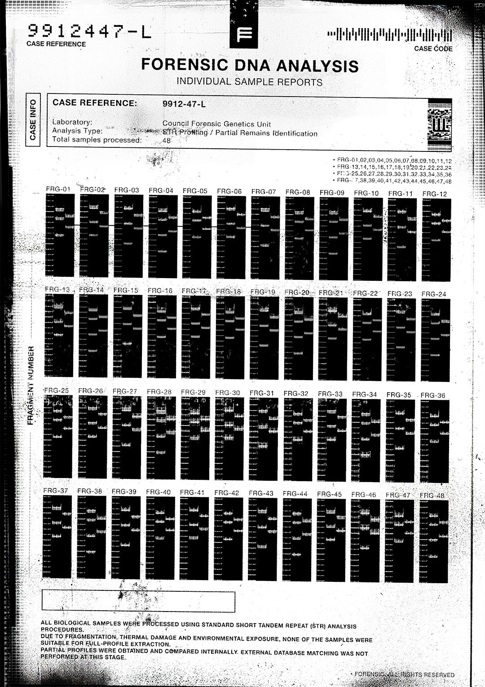

# R0OT_60G

- 分类：Entry 2: The Journey
- 类型：IMAGE
- entryId：019d5d98-f5d1-707f-9c1b-e03266ccfb80
- 配图：../../img/CFC4DA3F323BBB49.jpg

---

## 图片文字（中文翻译）

> 由配图转录并翻译；原文为英文，专有名词保留原文拼写

**表头**

- 案件编号（CASE REFERENCE）：9912447-L
- 案件代码（CASE CODE）：[条码，无法辨读]
- 标题：法医 DNA 分析 —— 个体样本报告（FORENSIC DNA ANALYSIS / INDIVIDUAL SAMPLE REPORTS）

**案件信息（CASE INFO）**

- 案件编号：9912-47-L
- 实验室：委员会法医遗传学部门（Council Forensic Genetics Unit）
- 分析类型：STR 分型 / 部分残骸身份识别（STR Profiling / Partial Remains Identification）
- 处理样本总数：48

**样本编号清单**

- FRG-01 至 FRG-12
- FRG-13 至 FRG-24
- FRG-25 至 FRG-36
- FRG-37 至 FRG-48

**凝胶电泳图**

- 共 48 条泳道，逐条标注 FRG-01 至 FRG-48；左侧纵轴标签为"片段编号"（FRAGMENT NUMBER）；每条泳道内为若干条横向条带。

**页脚说明**

所有生物样本均按标准短串联重复序列（STR）分析流程处理。

由于片段化、热损伤与环境暴露，没有任何样本适合提取完整图谱。

仅获得部分图谱，并已在内部进行比对。此阶段未进行外部数据库匹配。

右下角：法医档案 · 版权所有（FORENSIC · ALL RIGHTS RESERVED）
