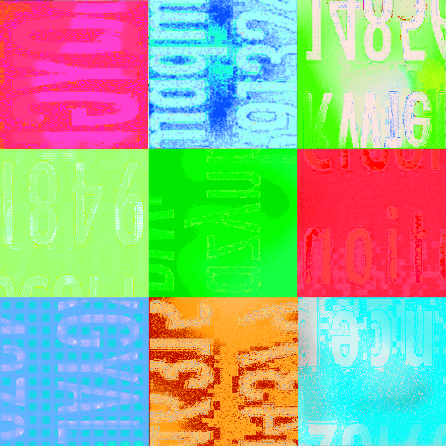

# 1043 号记录（Record 1043）

- 分类：Entry 2: The Journey
- 类型：IMAGE
- entryId：019d5d98-f5d1-7964-a9ed-fb1820be5504
- 配图：../../img/7587CA5505C387ED.png

---

## 图片文字（中文翻译）

> 由配图转录并翻译；原文为英文，专有名词保留原文拼写

[无法辨认]

配图是 3×3 共九格的拼贴画面：每一格都是一张印刷体文字的大特写照片碎片，被加上了强烈的色偏（品红、青、绿、橙、蓝等）与高反差、噪点效果，文字本身被翻转、镜像或旋转，并被裁切在格子边缘之外。只能辨认出零散的字母片段与数字（例如 "1485"、"4861"、"…ition"、"Wite…"），无法还原成完整的词句或段落。
