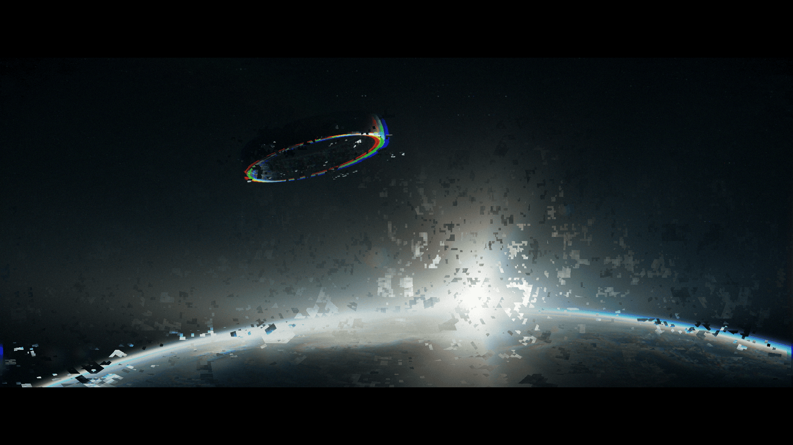

# 恢复的图像片段 — 2027（Recovered Image Fragment — 2027）

- 分类：Entry 2: The Journey
- 类型：IMAGE
- entryId：019d5d98-f5d1-79ea-991c-623af7c79538
- 配图：../../img/C5C9880E1AC3DB0F.png

---

## 图片说明

深空视角的画面：一颗行星的弧形地平线横贯画面下方，地平线上方悬着一个泛着彩虹色边缘的椭圆环状结构，环与地表之间是一团刺眼的白色爆闪，夹着大量像素化的碎片向下坠落。
