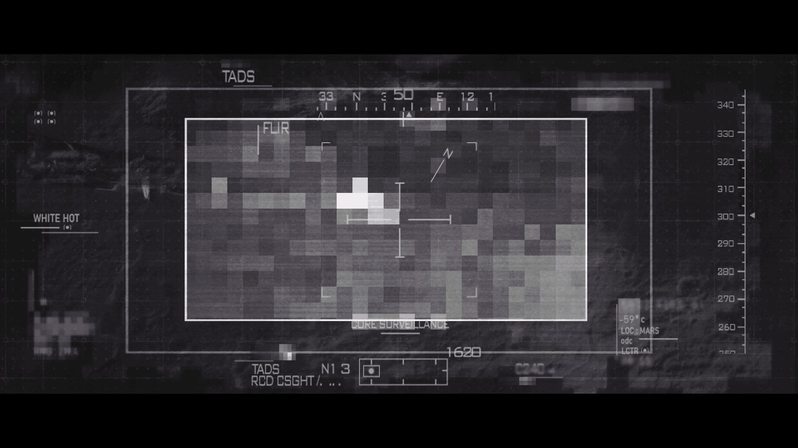

# 恢复的图像片段 — 2102（Recovered Image Fragment — 2102）

- 分类：Entry 2: The Journey
- 类型：IMAGE
- entryId：019d5d98-f5d1-7849-a255-52f86dc01550
- 配图：../../img/EBB16BE2ACB5793C.png

---

## 图片文字（中文翻译）

> 由配图转录并翻译；原文为英文，专有名词保留原文拼写

画面是一台热成像瞄准/监视终端（TADS）的取景界面，其上的可读文字为：

- TADS（终端名称，画面左上与左下各出现一次）
- FLIR（前视红外模式）
- WHITE HOT（白热显示模式）
- [?]ORE SURVELLANCE（"核心区监视"，首字母被准星箭头遮住；原文拼写如此）
- 33 N 50 E 12 1（顶部坐标/网格读数）
- 1620（画面下方读数）
- -59°C（温度读数）
- LOC: MARS（位置：火星）
- 右侧一列方位刻度：340、330、320、310、300、290、280、270、260、250
- 其余小字（如 "N1 3"、"RCD OSGHT"、"C204"、"AODC"、"LCTR" 等）[无法辨认]

（画面中央为像素化的灰白色热成像区域，其中一个白色高亮方块被十字准星标记为被追踪目标。）
