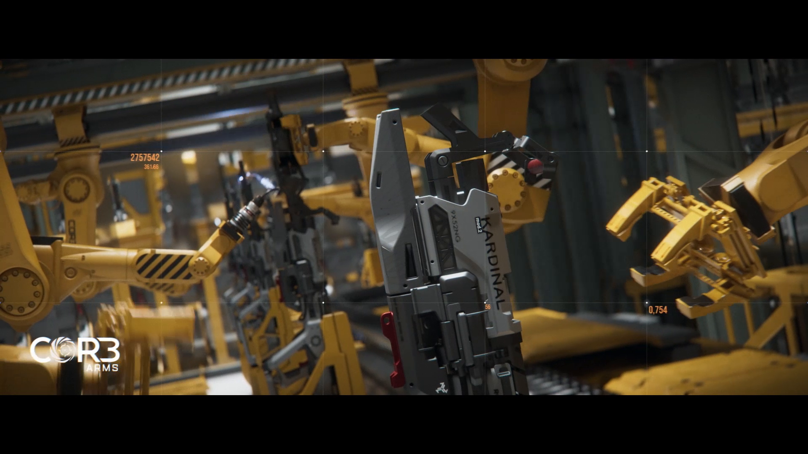

# 已恢复的影像碎片 —— 2113（Recovered Image Fragment — 2113）

- 分类：Entry 2: The Journey
- 类型：IMAGE
- entryId：019d5d98-f5d1-7c0f-bd4d-3fe4dfd7c546
- 配图：../../img/0919F21D90298636.png

---

## 图片文字（中文翻译）

> 由配图转录并翻译；原文为英文，专有名词保留原文拼写

画面为黄黑配色的自动化装配车间，多台黄色工业机械臂正夹持、装配一支灰色步枪。图上的可读文字为：

- COR3 ARMS（左下角的厂商标识）
- KARDINAL（枪身侧面的型号名，竖排）
- mod.2（同一位置的型号标记）
- 9X52NG（枪身标注的口径/弹种）
- 2757542、361.66（左上方的橙色读数）
- 0.754（右下方的橙色读数）
- 56（枪身附近的小号读数）
