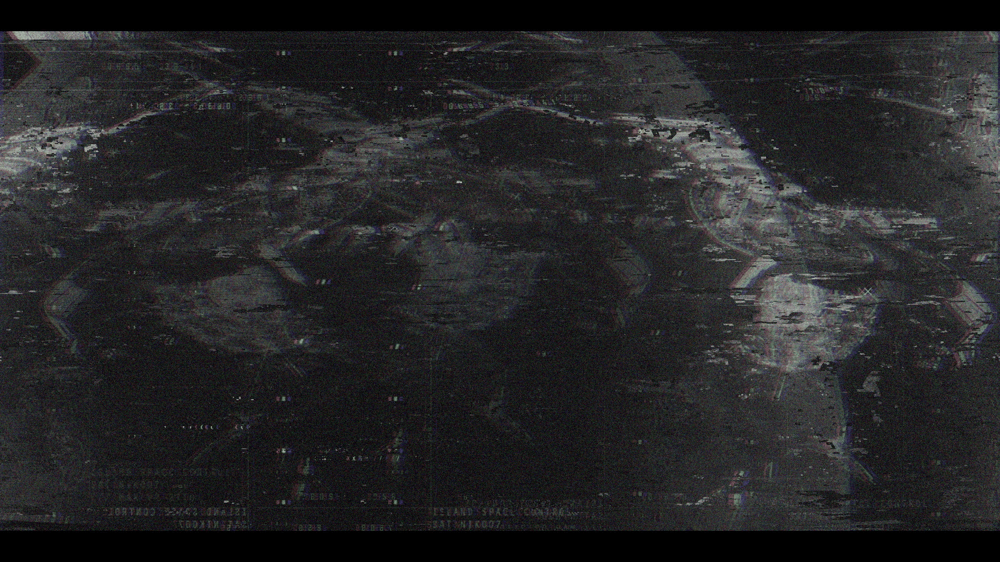

# 已恢复的影像碎片 —— 槽位 02（Recovered Image Fragment — Slot 02）

- 分类：Entry 2: The Journey
- 类型：IMAGE
- entryId：019d5d98-f5d1-72c9-9023-7a5b56934a76
- 配图：../../img/B75CEC755181AA14.png

---

## 图片说明

严重信号损坏的卫星俯瞰画面：大片暗色地表与交错的道路／峡谷状纹理，边缘带红蓝色散与块状噪点，画面底部残留的信号字幕已被干扰成 `[无法辨认]` 的乱码，整体氛围如同被截断的监视影像。
