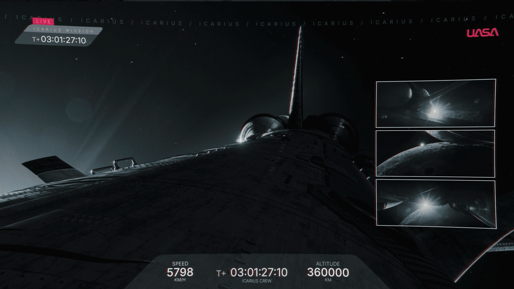

# 已恢复的影像碎片 —— 槽位 03（Recovered Image Fragment — Slot 03）

- 分类：Entry 2: The Journey
- 类型：IMAGE
- entryId：019d5d98-f5d1-781c-a890-26ddac8cb6c5
- 配图：../../img/A06EBBD450DBA0D8.png

---

## 图片文字（中文翻译）

> 由配图转录并翻译；原文为英文，专有名词保留原文拼写

- 左上角红色标签：`LIVE` —— 直播
- 其下：`ICARIUS MISSION` —— 伊卡洛斯任务
- 计时：`T+03:01:27:10` —— 任务已进行 03:01:27:10
- 顶部滚动条：`ICARIUS / ICARIUS / ICARIUS / …` —— 伊卡洛斯（重复滚动）
- 右上角机构标志：`NASA`
- 底部速度：`SPEED 5798 KM/H` —— 速度 5798 公里／小时
- 底部中央：`T+ 03:01:27:10` ／ `ICARIUS CREW` —— 伊卡洛斯乘员组
- 底部高度：`ALTITUDE 360000 KM` —— 高度 360000 公里

**画面内容：** 航天器外部的近距离视角，可见机身、尾翼与引擎喷口在星光下反光；右侧竖排三块小窗为外部摄像机画面，均拍到强光闪爆。
