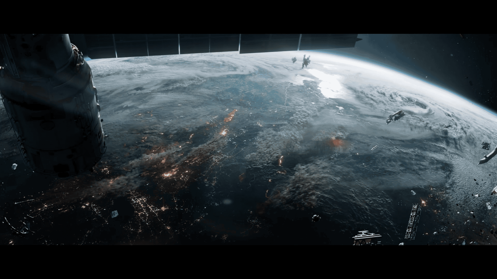

# 已恢复的影像碎片 —— 槽位 05（Recovered Image Fragment — Slot 05）

- 分类：Entry 2: The Journey
- 类型：IMAGE
- entryId：019d5d98-f5d1-728d-a119-afe228991264
- 配图：../../img/6AAB29DA91F052D9.png

---

## 图片说明

从空间站舷窗向外俯瞰地球的多云白昼面：地平线泛着冷光，云层下方有连片橙红色火光与城市灯网，近处可见巨大的航天器结构轮廓，远处散落着碎片与小型飞行器，气氛荒凉而紧张。
