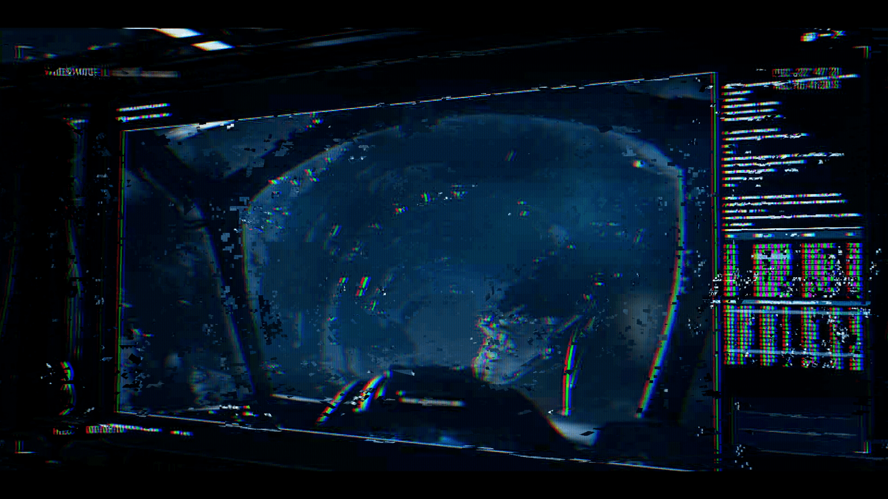

# 已恢复的影像碎片 —— 槽位 06（Recovered Image Fragment — Slot 06）

- 分类：Entry 2: The Journey
- 类型：IMAGE
- entryId：019d5d98-f5d1-7df5-a6dd-65ad4bde50fa
- 配图：../../img/CA42A34AD8E8F064.png

---

## 图片说明

夜航飞行器座舱内的视角：深蓝色舷窗外是巨大星球的弧面与云层，画面被严重的数字噪点、色散条纹与数据乱码覆盖，右侧一列柱状数据界面同样被干扰成 `[无法辨认]` 的字符，整体像一段损坏的飞行记录影像。
