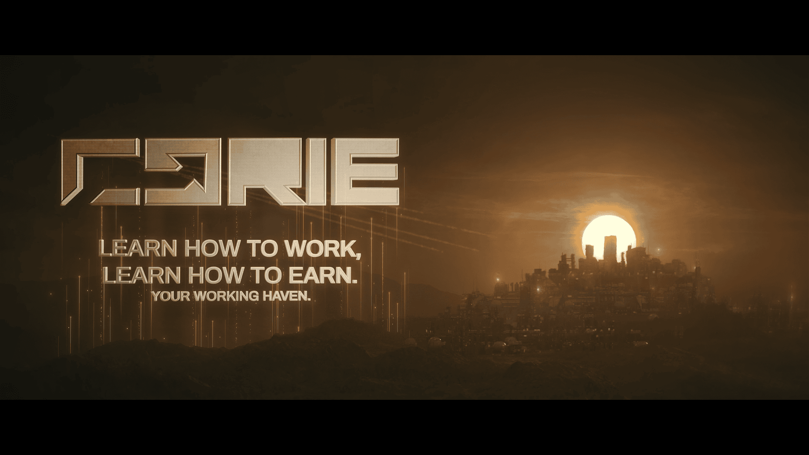

# 已恢复的影像碎片 —— 槽位 07（Recovered Image Fragment — Slot 07）

- 分类：Entry 2: The Journey
- 类型：IMAGE
- entryId：019d5d98-f5d1-7a40-982a-46160597fc71
- 配图：../../img/8EBE617EDC7B46D3.png

---

## 图片文字（中文翻译）

> 由配图转录并翻译；原文为英文，专有名词保留原文拼写

- 主标志：`CORE` —— CORE（公司名，保留原文）
- 宣传语第 1 行：`LEARN HOW TO WORK,` —— 学会工作，
- 宣传语第 2 行：`LEARN HOW TO EARN.` —— 学会挣得。
- 小字副标：`YOUR WORKING HAVEN.` —— 你的工作乐土。

**画面内容：** 金褐色调的巨型广告牌，左侧是金属质感的 CORE 字标与垂落的光带，右侧是一座依山而建的密集工业城市剪影，一轮巨大的落日正好卡在城市天际线后方。
