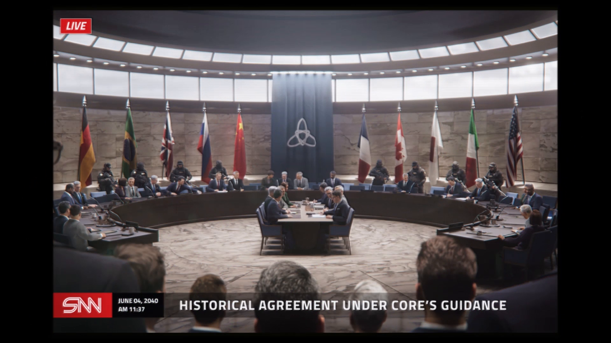

# 已恢复的影像碎片 —— 槽位 08（Recovered Image Fragment — Slot 08）

- 分类：Entry 2: The Journey
- 类型：IMAGE
- entryId：019d5d98-f5d1-75da-a76d-b3f2d464b79d
- 配图：../../img/DD375BA695CEAE70.png

---

## 图片文字（中文翻译）

> 由配图转录并翻译；原文为英文，专有名词保留原文拼写

- 左上角红色标签：`LIVE` —— 直播
- 左下角台标：`SNN`
- 台标旁日期时间：`JUNE 04, 2040` ／ `AM 11:37` —— 2040 年 6 月 4 日 上午 11:37
- 底部新闻标题：`HISTORICAL AGREEMENT UNDER CORE'S GUIDANCE` —— 在 CORE 主导下达成历史性协议

**画面内容：** 一间环形大会厅内，各国代表围坐在巨大的弧形会议桌旁，中央另设一张小方桌供签署文件；后墙两端依次悬挂德国、巴西、英国、俄罗斯、中国、法国、加拿大、日本、意大利、美国国旗，正中垂着一面印有三角结徽记的深蓝色幕旗，两侧站有全副武装的安保人员，前景是记者与旁听者的后脑勺。
