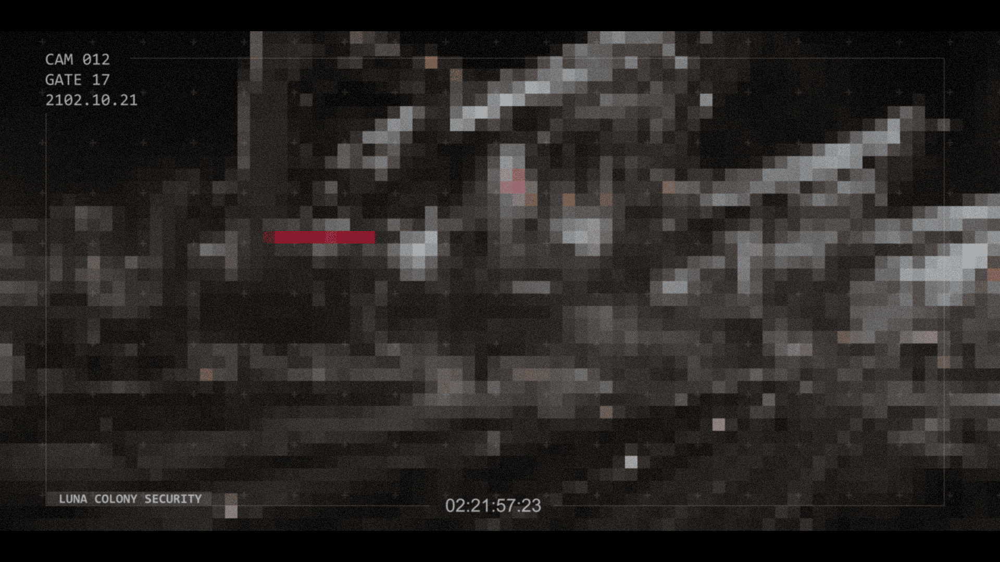

# 已恢复的影像碎片 —— 槽位 09（Recovered Image Fragment — Slot 09）

- 分类：Entry 2: The Journey
- 类型：IMAGE
- entryId：019d5d98-f5d1-7a3a-a02c-19e8304aa659
- 配图：../../img/3F2A6D627CE41A24.png

---

## 图片文字（中文翻译）

> 由配图转录并翻译；原文为英文，专有名词保留原文拼写

- 左上角三行：`CAM 012` ／ `GATE 17` ／ `2102.10.21`
  —— 摄像头 012 ／ 17 号闸门 ／ 2102 年 10 月 21 日
- 左下角：`LUNA COLONY SECURITY` —— 月球殖民地安保
- 底部中央时间码：`02:21:57:23`
- 画面中部有一道红色标签条，其上文字为 `[无法辨认]`

**画面内容：** 极低分辨率、马赛克化的黑白监控画面，看得出是舱门／通道口的金属构件，四角带取景框线，整体是典型的安保摄像头取证截图。
