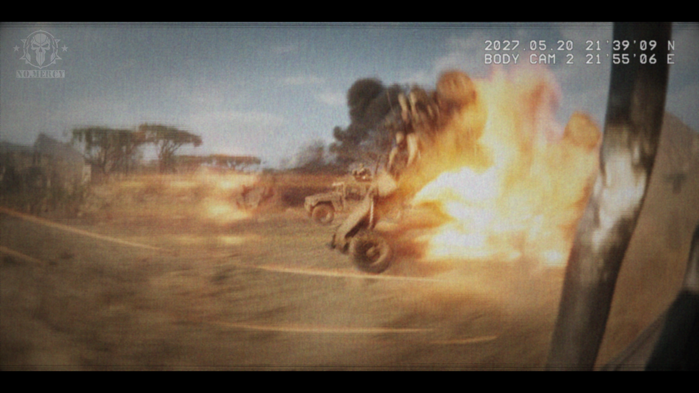

# 已恢复的影像碎片 —— 槽位 10（Recovered Image Fragment — Slot 10）

- 分类：Entry 2: The Journey
- 类型：IMAGE
- entryId：019d5d98-f5d1-7790-904a-8ca7260c5ada
- 配图：../../img/5CD1E729776B55B6.png

---

## 图片文字（中文翻译）

> 由配图转录并翻译；原文为英文，专有名词保留原文拼写

- 左上角徽标下：`NO MERCY` —— 绝不留情（队名／标语）
- 右上角两行：`2027.05.20 21:39'09 N` ／ `BODY CAM 2 21'55'06 E`
  —— 2027 年 5 月 20 日 ／ 随身摄像头 2 ／ 坐标 21°39'09"N、21°55'06"E

**画面内容：** 一段摇晃模糊的战场随身摄像记录：沙土路面上，一辆载人越野车正被巨大的橙黄色爆炸火球吞没，冲击波掀起尘土，左侧远处有稀疏的金合欢树与营地棚屋，右侧是拍摄者所在的车辆边框。
