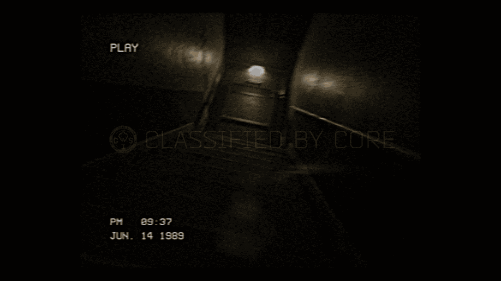

# 已恢复的影像碎片 —— 槽位 11（Recovered Image Fragment — Slot 11）

- 分类：Entry 2: The Journey
- 类型：IMAGE
- entryId：019d5d98-f5d1-7829-bac2-14d2597d6266
- 配图：../../img/6780A1C4566B2788.png

---

## 图片文字（中文翻译）

> 由配图转录并翻译；原文为英文，专有名词保留原文拼写

- 左上角：`PLAY` —— 播放
- 画面中部横幅：`CLASSIFIED BY CORE` —— 由 CORE 列为机密
- 横幅左侧圆形徽标内的字母为 `[无法辨认]`
- 左下角两行：`PM 09:37` ／ `JUN. 14 1989`
  —— 下午 09:37 ／ 1989 年 6 月 14 日

**画面内容：** 一盘老旧录像带的播放画面：极暗的走廊／舱道内只有零星几盏顶灯，画面满是颗粒与扫描线，左上有播放指示字样，整体像被归档封存的监控母带。
